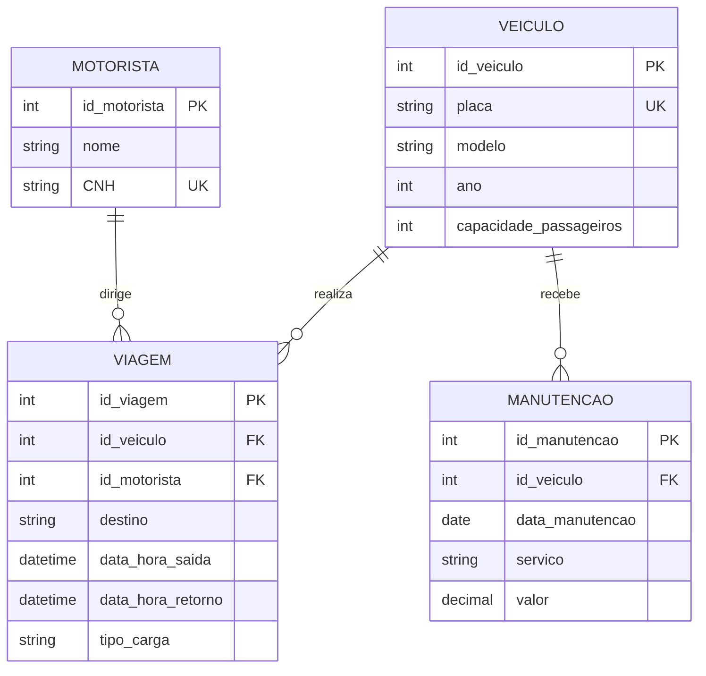

# Exercicio 04 - Controle de veiculos

O modelo registra os veiculos da frota, os motoristas, as viagens realizadas e as manutencoes. Cada viagem usa um veiculo e tem um motorista responsavel. Cada manutencao fica ligada ao veiculo que recebeu o servico.

O enunciado informa que a frota tem sete veiculos, mas esse numero representa a quantidade inicial de registros, nao uma regra que limita o banco a sete veiculos.

Cardinalidades: um veiculo pode ainda nao ter viagens ou manutencoes, ou pode ter varias. Cada viagem e cada manutencao pertence a exatamente um veiculo. Um motorista pode nao ter viagens cadastradas ou pode realizar varias; cada viagem tem exatamente um motorista.
