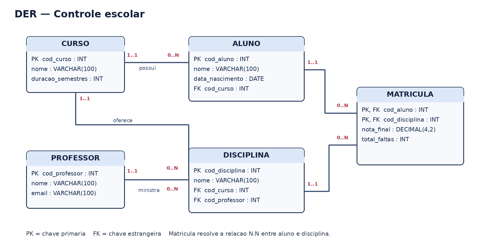
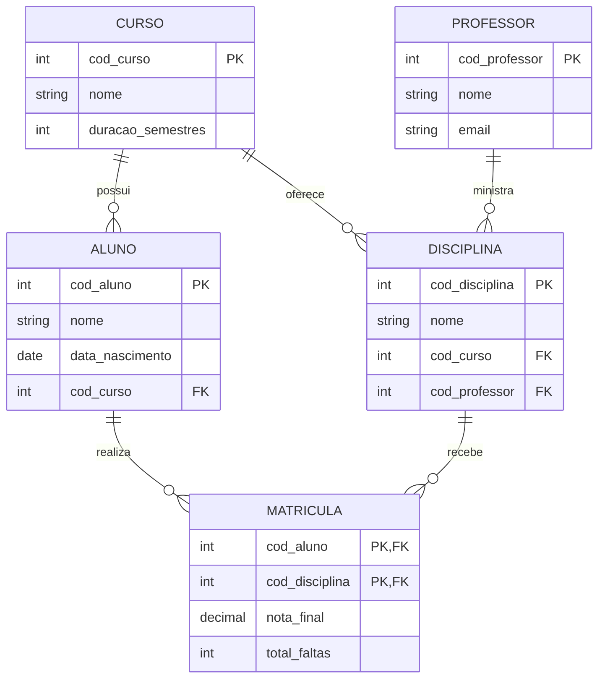

# Exercicio 05 - Controle escolar

O modelo permite consultar o curso de cada aluno, as disciplinas de cada curso, o professor responsavel por uma disciplina e as disciplinas cursadas por cada aluno. A tabela `Matricula` resolve a relacao muitos-para-muitos entre aluno e disciplina e guarda a nota final e o total de faltas.

Cada aluno pertence a um curso. Cada disciplina pertence a um unico curso e tem um professor responsavel. Um curso, um professor, um aluno ou uma disciplina podem existir sem registros relacionados. A chave primaria composta de `Matricula` impede cadastrar mais de uma vez o mesmo aluno na mesma disciplina.

O script SQL Server desta resolucao esta em [Exercicio04.sql](../CriacaoDeBancos/Exercicio04.sql).

## DER

