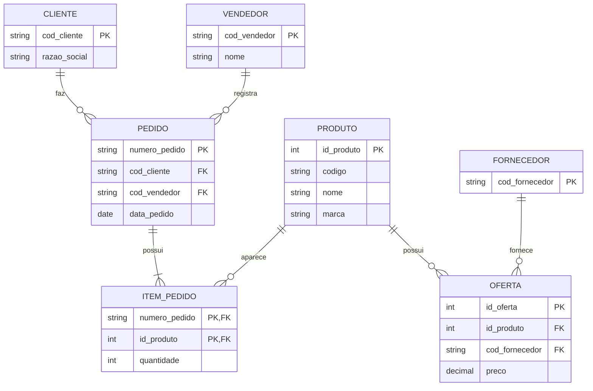

# Exercicio 06 - Controle de pedidos

O modelo registra o pedido, o cliente, o vendedor e os produtos. A tabela `ITEM_PEDIDO` guarda a quantidade de cada produto no pedido. A tabela `OFERTA` relaciona cada produto ao fornecedor e ao preco da lista.

Foi usado um identificador interno para o produto, porque o codigo mostrado na lista nao e unico: o codigo `008` aparece para duas marcas diferentes. O codigo do fornecedor tambem e texto para preservar os zeros a esquerda.

Observacao: no exemplo, o pedido contem os codigos `101`, `004`, `012` e `068`, mas a lista de precos mostra `001`, `004`, `005` e `008`. Assim, somente o produto de codigo `004` aparece nos dois documentos. Alem disso, para pedidos futuros com o codigo `008`, seria necessario registrar tambem a marca (ou outro identificador) para saber qual produto foi escolhido.
