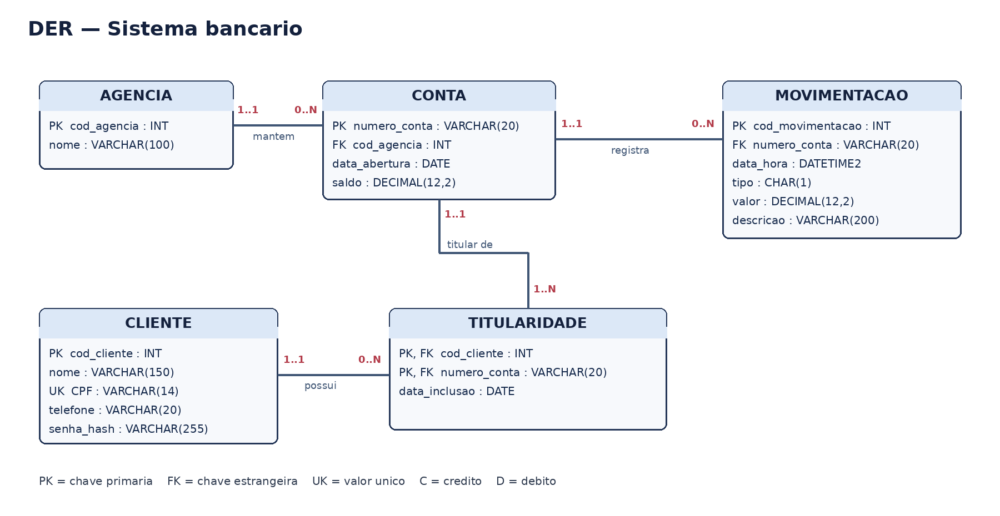
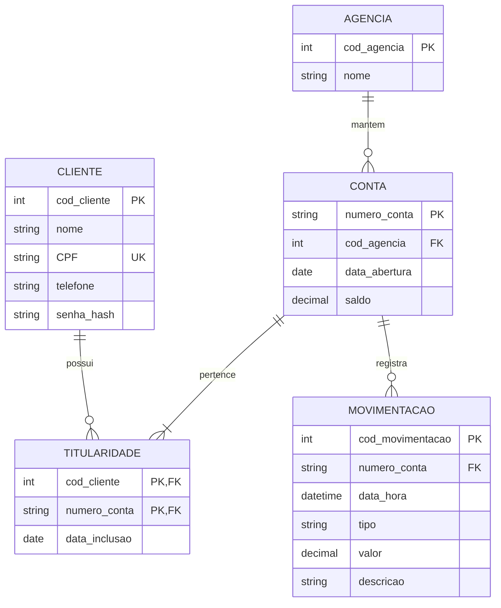

# Exercicio 09 - Sistema bancario

O modelo permite contas conjuntas e que um cliente possua contas em agencias diferentes. O numero da conta e chave primaria global, sem depender do codigo da agencia. A senha fica ligada ao cliente, assim cada titular usa sua propria senha mesmo quando a conta e conjunta. No banco, a senha deve ser armazenada como hash, nunca em texto puro.

O saldo inicial da conta e zero, portanto nao e necessario um deposito na abertura. Creditos e debitos sao registrados em `Movimentacao`; o campo `tipo` usa `C` para credito e `D` para debito. O sistema deve atualizar o saldo junto com cada movimentacao.

Script SQL Server: [Exercicio09.sql](Exercicio09.sql).

## DER

