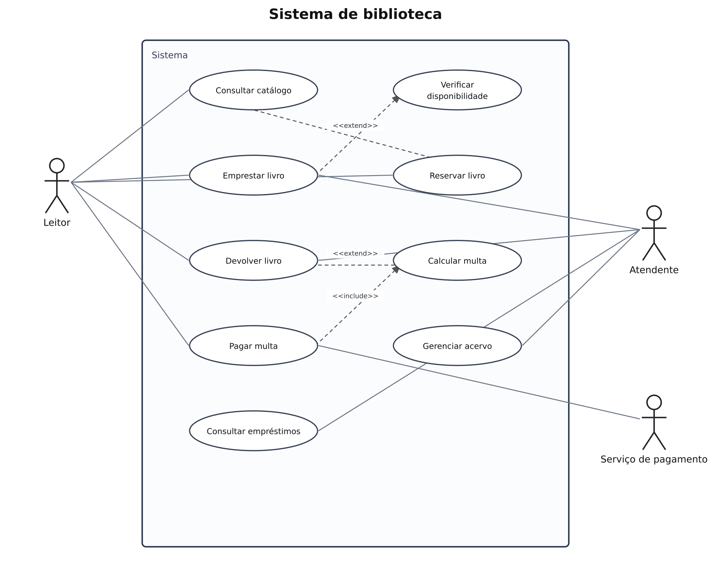

# Biblioteca — casos de uso

## Problema

Sistema de biblioteca para cadastrar leitores e livros e controlar empréstimos, devoluções e reservas.

## Objetivo do diagrama

Identificar os atores, os objetivos de cada ator e os relacionamentos entre os casos de uso.

## Diagrama de estudo

Exemplo complementar organizado com apoio de IA para praticar a notação. Referência para praticar no Lucidchart.

[Abrir imagem](Diagrama.png)

## Prática no Lucidchart

Usar este problema para montar ou revisar o diagrama manualmente no Lucidchart e exportar a imagem. Quando houver uma nova exportação da atividade, ela deve ficar nesta pasta, com a versão identificada.

[Voltar aos problemas](../README.md) · [Resumo da aula](../ResumoDaAula.md)
