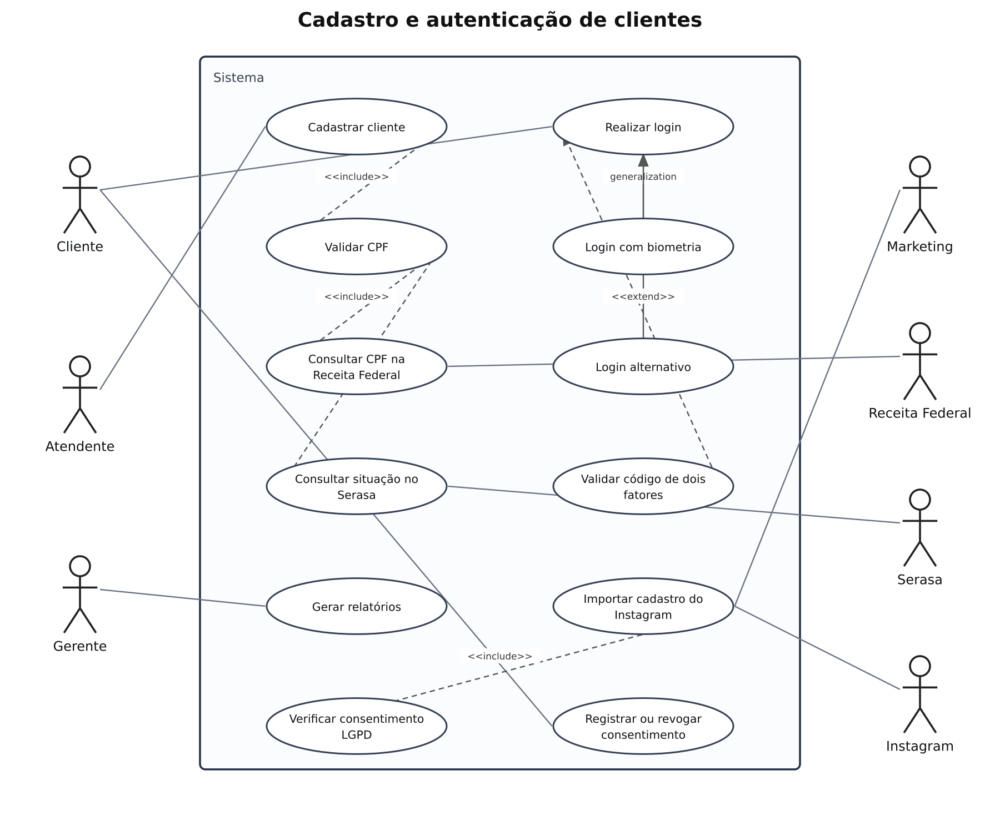

# Cadastro e autenticação — casos de uso

## Problema

Sistema de cadastro e acesso baseado no cenário da aula “Modelagem Frankenstein”. O exemplo considera biometria opcional e um método alternativo de acesso.

## Objetivo do diagrama

Identificar os atores, os objetivos de cada ator e os relacionamentos entre os casos de uso.

## Diagrama de estudo

Exemplo complementar organizado com apoio de IA para praticar a notação. Referência para praticar no Lucidchart.

[Abrir imagem](Diagrama.png)

## Leitura do modelo

Os requisitos recebidos entram em conflito: alguns dizem que a biometria é obrigatória, enquanto outros pedem login alternativo para clientes que não querem ou não podem usá-la. Para deixar o modelo coerente, este diagrama assume que a biometria é uma opção de autenticação, junto com um método alternativo; o segundo fator é solicitado conforme a configuração do usuário ou a política de acesso. A consulta de CPF à Receita Federal e ao Serasa está separada. A importação de dados do Instagram depende da verificação do consentimento e das regras de privacidade.

## Prática no Lucidchart

Usar este problema para montar ou revisar o diagrama manualmente no Lucidchart e exportar a imagem. Quando houver uma nova exportação da atividade, ela deve ficar nesta pasta, com a versão identificada.

[Voltar aos problemas](../README.md) · [Resumo da aula](../ResumoDaAula.md)
