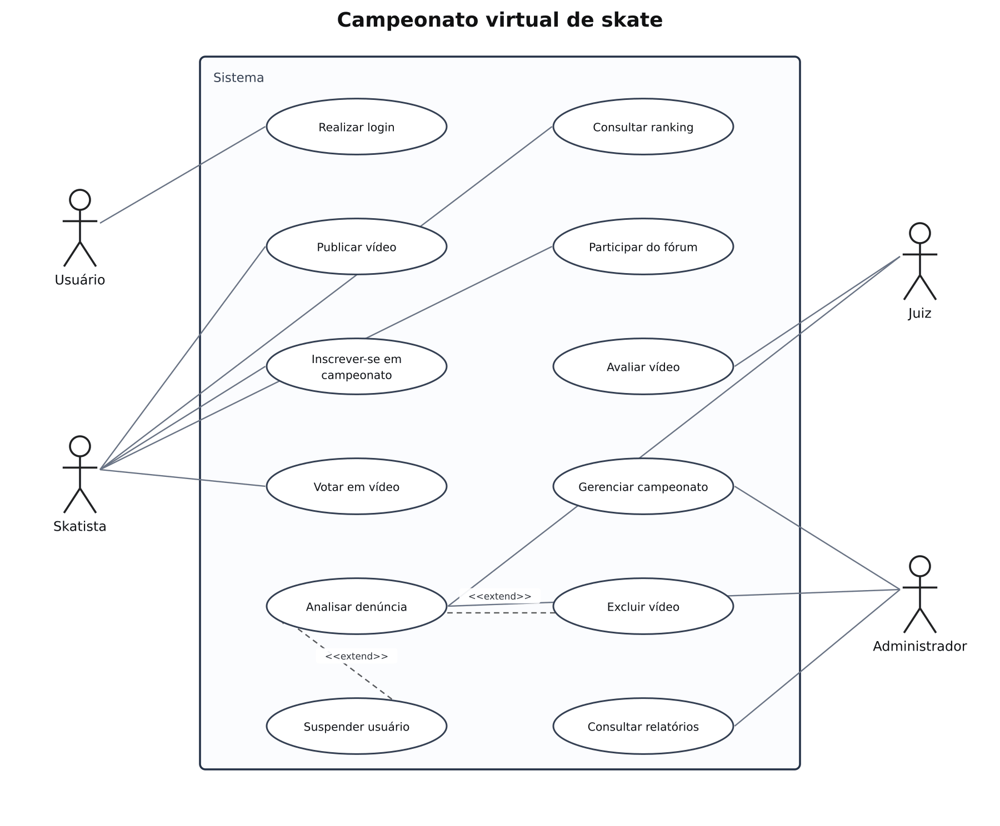

# Campeonato de skate — casos de uso

## Problema

Sistema para gerenciar campeonatos virtuais de skate, inscrições, vídeos e avaliações.

## Objetivo do diagrama

Identificar os atores, os objetivos de cada ator e os relacionamentos entre os casos de uso.

## Diagrama de estudo

Exemplo complementar organizado com apoio de IA para praticar a notação. Referência para praticar no Lucidchart.

[Abrir imagem](Diagrama.png)

## Leitura do modelo

O exemplo mantém ações como publicar vídeo, inscrever-se em campeonato, votar, consultar ranking e participar do fórum. A análise de denúncia pode ser ampliada por ações condicionais, como excluir um vídeo ou suspender um usuário.

## Referência enviada

[Ver a imagem original enviada](Original_Enviado.png). A imagem de estudo acima é uma reorganização, não uma exportação desse original.

## Prática no Lucidchart

Usar este problema para montar ou revisar o diagrama manualmente no Lucidchart e exportar a imagem. Quando houver uma nova exportação da atividade, ela deve ficar nesta pasta, com a versão identificada.

[Voltar aos problemas](../README.md) · [Resumo da aula](../ResumoDaAula.md)
