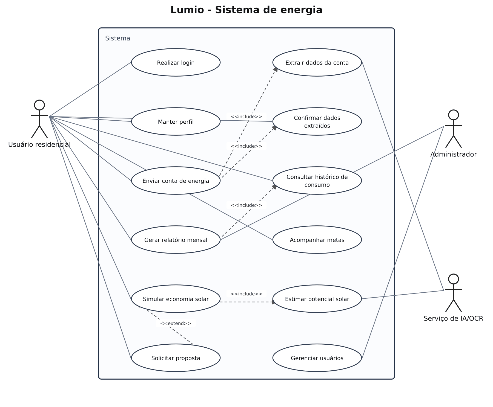

# Lumio — casos de uso

## Problema

Sistema para acompanhar contas de energia e analisar o consumo dos usuários.

## Objetivo do diagrama

Identificar os atores, os objetivos de cada ator e os relacionamentos entre os casos de uso.

## Diagrama de estudo

Modelo de estudo do projeto Lumio.

[Abrir imagem](Diagrama.png)

## Leitura do modelo

O diagrama digital organiza os fluxos do usuário residencial, do administrador e do serviço de IA/OCR. Enviar uma conta inclui extrair seus dados; a simulação inclui estimar o potencial solar; solicitar uma proposta é opcional após a simulação.

## Referência enviada

[Ver a imagem original enviada](Original_Enviado.png). A imagem de estudo acima é uma reorganização, não uma exportação desse original.

## Prática no Lucidchart

Usar este problema para montar ou revisar o diagrama manualmente no Lucidchart e exportar a imagem. Quando houver uma nova exportação da atividade, ela deve ficar nesta pasta, com a versão identificada.

[Voltar aos problemas](../README.md) · [Resumo da aula](../ResumoDaAula.md)
