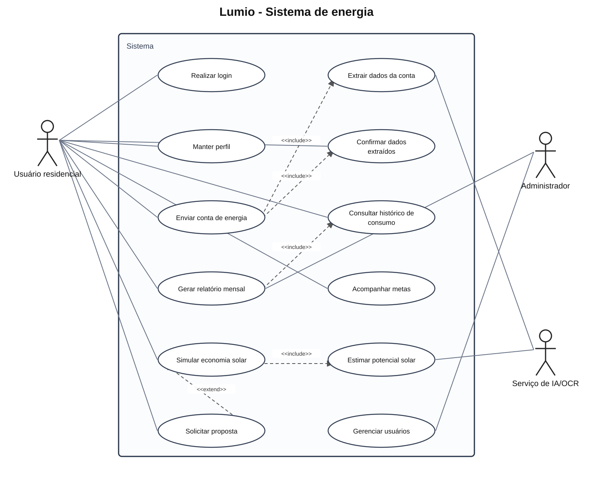
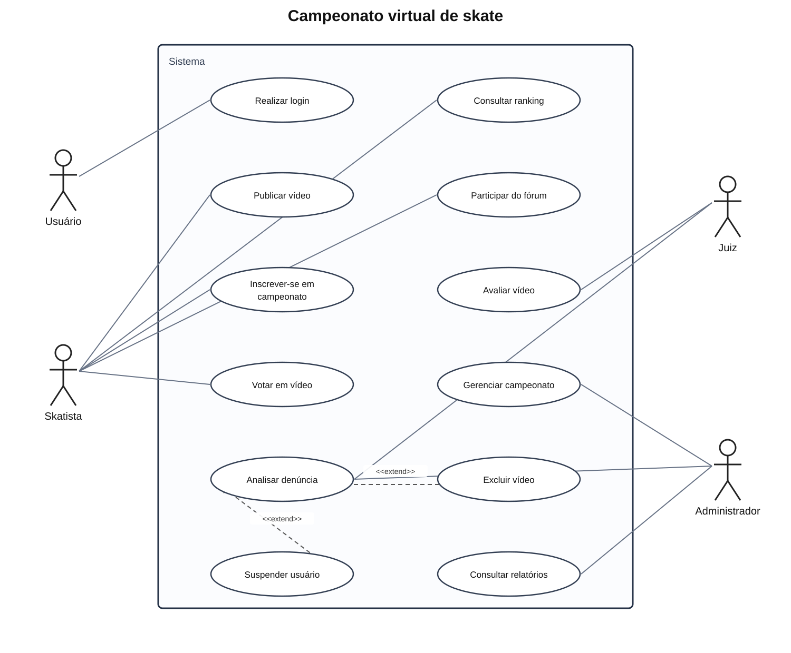
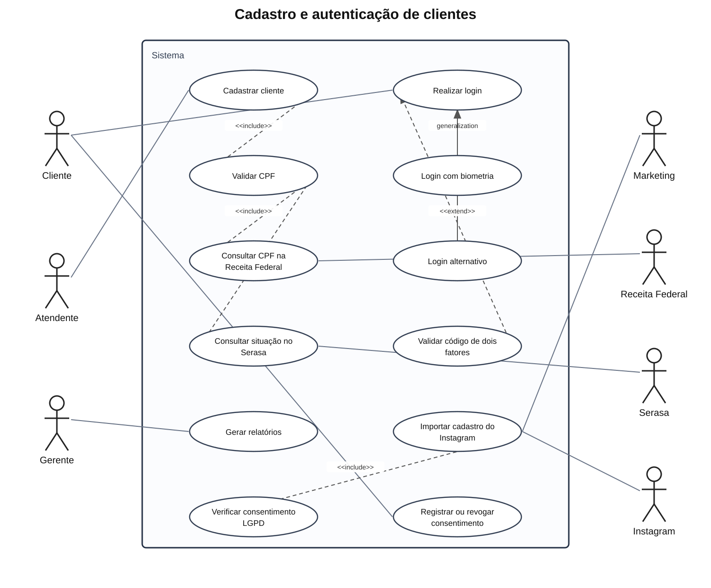
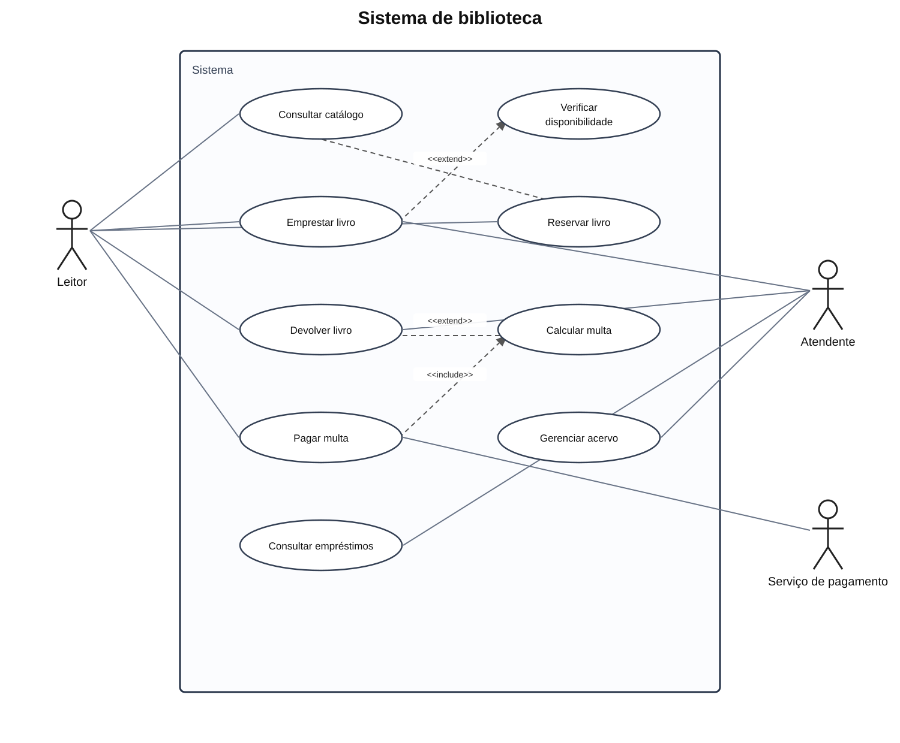
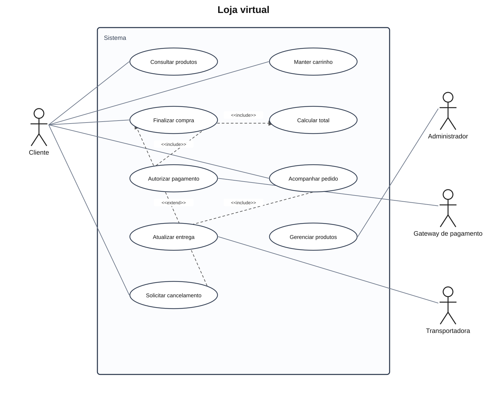

# Diagramas de Casos de Uso

Material de estudo da disciplina Análise de Sistemas, no terceiro semestre. O Lumio é o modelo principal; os outros quatro diagramas usam sistemas distintos para praticar a mesma notação.

## Aprendizados da aula

- Um caso de uso descreve um objetivo ou serviço que o sistema oferece a um ator.
- Atores representam pessoas, organizações, dispositivos ou sistemas externos que interagem com o sistema. Eles ficam fora do limite do sistema.
- Os casos de uso ficam dentro do limite do sistema e devem ter nomes que expressem ações e resultados, como “Enviar conta de energia”.
- A associação mostra que um ator participa de um caso de uso.
- `<<include>>` indica um comportamento obrigatório reutilizado por outro caso de uso. A seta parte do caso de uso principal para o caso incluído.
- `<<extend>>` indica um comportamento opcional ou condicional que amplia um caso de uso base. A seta parte do caso de extensão para o caso base.
- Não é necessário transformar cada clique, tela ou passo interno em caso de uso. O diagrama deve mostrar os objetivos e o escopo do sistema.

## Os cinco diagramas

| Sistema | Uso no material | Diagrama | Fonte editável |
|---|---|---|---|
| Lumio | Projeto principal: conta de energia, histórico e simulação | [SVG](Diagramas/Lumio.svg) | [PlantUML](Diagramas/Lumio.puml) |
| Campeonato virtual de skate | Diagrama enviado como exemplo de outro domínio | [SVG](Diagramas/Campeonato_Skate.svg) | [PlantUML](Diagramas/Campeonato_Skate.puml) |
| Cadastro e autenticação | Exemplo baseado nos requisitos “Modelagem Frankenstein” | [SVG](Diagramas/Cadastro_Autenticacao.svg) | [PlantUML](Diagramas/Cadastro_Autenticacao.puml) |
| Biblioteca | Exemplo genérico para empréstimo e devolução de livros | [SVG](Diagramas/Biblioteca.svg) | [PlantUML](Diagramas/Biblioteca.puml) |
| Loja virtual | Exemplo genérico para compra e entrega de produtos | [SVG](Diagramas/Loja_Virtual.svg) | [PlantUML](Diagramas/Loja_Virtual.puml) |

Os cinco arquivos `.puml` são fontes editáveis e podem ser abertos em um editor PlantUML. Os diagramas também foram exportados em SVG para aparecerem diretamente no GitHub.

### Pré-visualizações

#### Lumio — exemplo principal

#### Campeonato virtual de skate

#### Cadastro e autenticação

#### Biblioteca

#### Loja virtual

## Observações sobre os modelos

### Lumio

O diagrama digital organiza os fluxos do usuário residencial, do administrador e do serviço de IA/OCR. Enviar uma conta inclui extrair seus dados; a simulação inclui estimar o potencial solar; solicitar uma proposta é opcional após a simulação.

### Campeonato de skate

O exemplo mantém ações como publicar vídeo, inscrever-se em campeonato, votar, consultar ranking e participar do fórum. A análise de denúncia pode ser ampliada por ações condicionais, como excluir um vídeo ou suspender um usuário.

### Cadastro e autenticação (“Modelagem Frankenstein”)

Os requisitos recebidos entram em conflito: alguns dizem que a biometria é obrigatória, enquanto outros pedem login alternativo para clientes que não querem ou não podem usá-la. Para deixar o modelo coerente, este diagrama assume que a biometria é uma opção de autenticação, junto com um método alternativo; o segundo fator é solicitado conforme a configuração do usuário ou a política de acesso. A consulta de CPF à Receita Federal e ao Serasa está separada. A importação de dados do Instagram depende da verificação do consentimento e das regras de privacidade.

### Biblioteca e loja virtual

São exemplos independentes para treinar associações entre atores e objetivos do sistema, além de relações obrigatórias `<<include>>` e extensões condicionais `<<extend>>`.

## Ideias para ampliar o diagrama de skate

O arquivo [Ideias_Campeonato_Skate.md](Ideias_Campeonato_Skate.md) reúne as funcionalidades sugeridas para evoluir o sistema, como gestão de campeonatos, vídeos, avaliações, denúncias, relatórios, segurança e integrações.

## Material de referência

Os conceitos desta página foram organizados a partir dos slides de casos de uso enviados para a aula e dos diagramas de Lumio e campeonato de skate. Os cinco modelos em SVG e PlantUML são as versões digitais organizadas para estudo.
