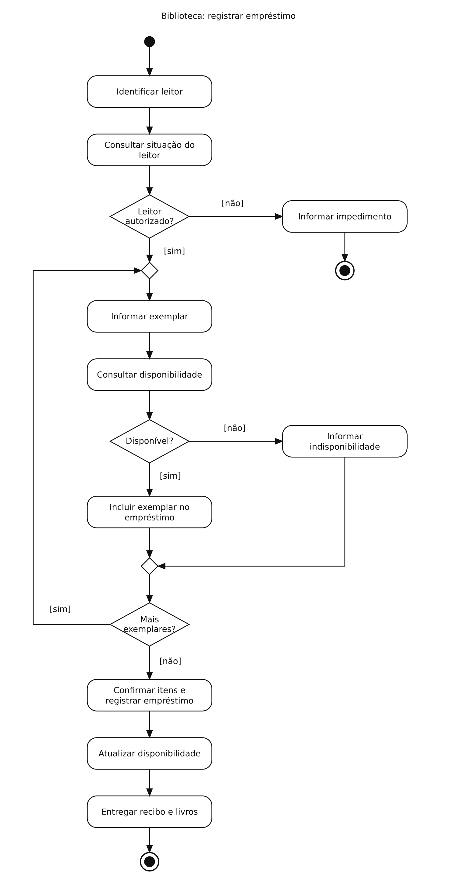

# Biblioteca — Diagrama de atividades

## Problema

Verificar o leitor e registrar o empréstimo dos exemplares disponíveis.

## Diagrama

Exemplo de estudo para praticar a modelagem no Lucidchart.

[Abrir imagem](Diagrama.png)

## Leitura do fluxo

Leitor impedido encerra a atividade. Para cada exemplar, o sistema verifica a disponibilidade. O fluxo se repete enquanto houver exemplares a informar. Ao final, os itens aceitos são registrados e o recibo é entregue.

**Premissa:** pelo menos um exemplar disponível foi aceito antes da confirmação. Para detalhar o processo, acrescentar a verificação de lista vazia e a revalidação da disponibilidade na gravação.

[Voltar aos problemas](../README.md) · [Resumo da aula](../ResumoDaAula.md)
