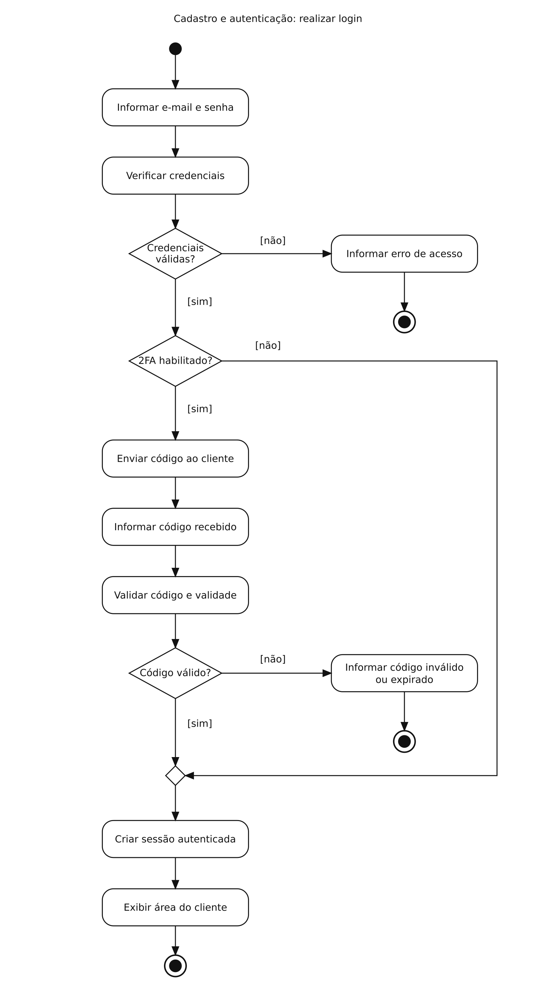

# Cadastro e autenticação — Diagrama de atividades

## Problema

Permitir acesso após verificar credenciais e, quando habilitado, o segundo fator.

## Diagrama

Exemplo de estudo para praticar a modelagem no Lucidchart.

[Abrir imagem](Diagrama.png)

## Leitura do fluxo

Credenciais inválidas ou código inválido encerram a tentativa. O caminho sem 2FA e o caminho com código válido se unem em um nó de união antes da criação da sessão.

**Recorte:** o desenho mostra as regras principais e considera os serviços disponíveis. Falhas técnicas e cancelamento podem ser detalhados em outra versão.

[Voltar aos problemas](../README.md) · [Resumo da aula](../ResumoDaAula.md)
