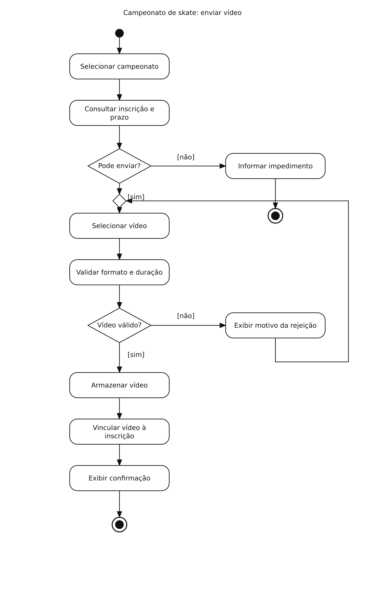

# Campeonato de skate — Diagrama de atividades

## Problema

Verificar inscrição e prazo antes de receber e registrar o vídeo de um skatista.

## Diagrama

Exemplo de estudo para praticar a modelagem no Lucidchart.

[Abrir imagem](Diagrama.png)

## Leitura do fluxo

Inscrição ou prazo inválido encerram a atividade com uma mensagem. Vídeo inválido permite selecionar outro. Vídeo válido é armazenado e vinculado à inscrição.

**Recorte:** o desenho mostra as regras principais e considera os serviços disponíveis. Falhas técnicas e cancelamento podem ser detalhados em outra versão.

[Voltar aos problemas](../README.md) · [Resumo da aula](../ResumoDaAula.md)
