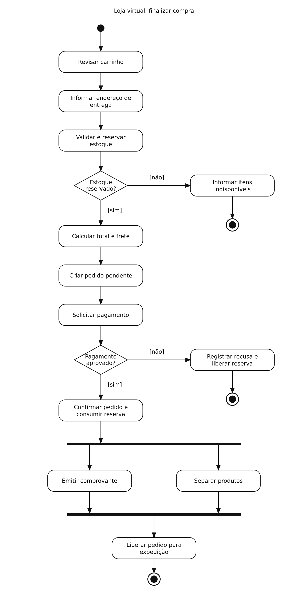

# Loja virtual — Diagrama de atividades

## Problema

Validar estoque e pagamento e preparar o pedido aprovado para expedição.

## Diagrama

Exemplo de estudo para praticar a modelagem no Lucidchart.

[Abrir imagem](Diagrama.png)

## Leitura do fluxo

Após a confirmação do pedido, emitir o comprovante e separar os produtos são ações paralelas. A barra de sincronização aguarda as duas antes de liberar a expedição.

**Recorte:** o pagamento responde imediatamente. Falhas de comunicação, expiração de reserva e falhas na confirmação exigem fluxos adicionais. A separação física não equivale ao envio da mercadoria.

[Voltar aos problemas](../README.md) · [Resumo da aula](../ResumoDaAula.md)
