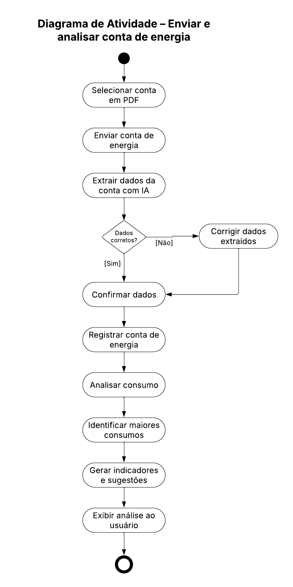

# Lumio — Diagrama de atividades

## Problema

Receber a conta em PDF, extrair os dados, permitir a conferência e apresentar a análise de consumo.

## Diagrama

Diagrama enviado para o projeto principal. A imagem foi preservada sem alterações.

[Abrir imagem](Diagrama.png)

## Leitura do fluxo

O usuário seleciona e envia o PDF. O sistema extrai os dados. Se houver divergências, o usuário corrige as informações antes de confirmar. Em seguida, a conta é registrada e o sistema gera a análise.

## Ajustes para revisar no Lucidchart

- Inserir um **nó de união (merge)** antes de “Confirmar dados”. O caminho [Sim] de “Dados corretos?” e o caminho que sai de “Corrigir dados extraídos” devem chegar ao losango. Dele sai uma única seta para a confirmação. São alternativas, e não ações paralelas a sincronizar.
- Representar o **final de atividade** com um círculo preenchido dentro de um círculo externo. A imagem enviada tem apenas o contorno externo com centro vazio.
- Especificar “Identificar maiores consumos”. Com histórico de contas, é possível comparar os meses. Para identificar aparelhos, são necessários dados adicionais de equipamentos e de uso ou medição. A conta isolada não fornece esse detalhamento.

A revisão está descrita aqui para ser aplicada no Lucidchart. A imagem acima continua sendo o arquivo recebido.

[Voltar aos problemas](../README.md) · [Resumo da aula](../ResumoDaAula.md)
