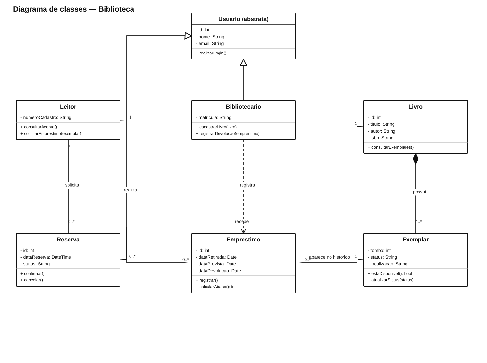
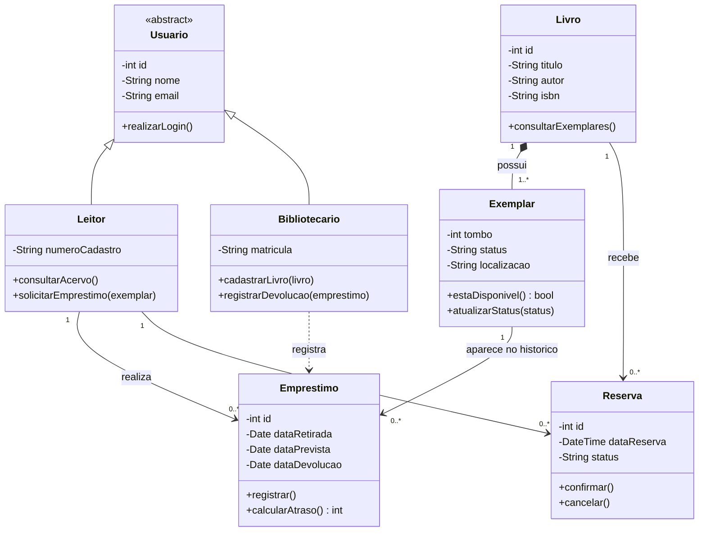

# Biblioteca

Modelo para controlar leitores, acervo, empréstimos e reservas.

[Fonte PlantUML editável](Biblioteca.puml)

**Premissa:** um livro pode ter vários exemplares físicos. O histórico de empréstimos é preservado, mesmo depois da devolução do exemplar.
