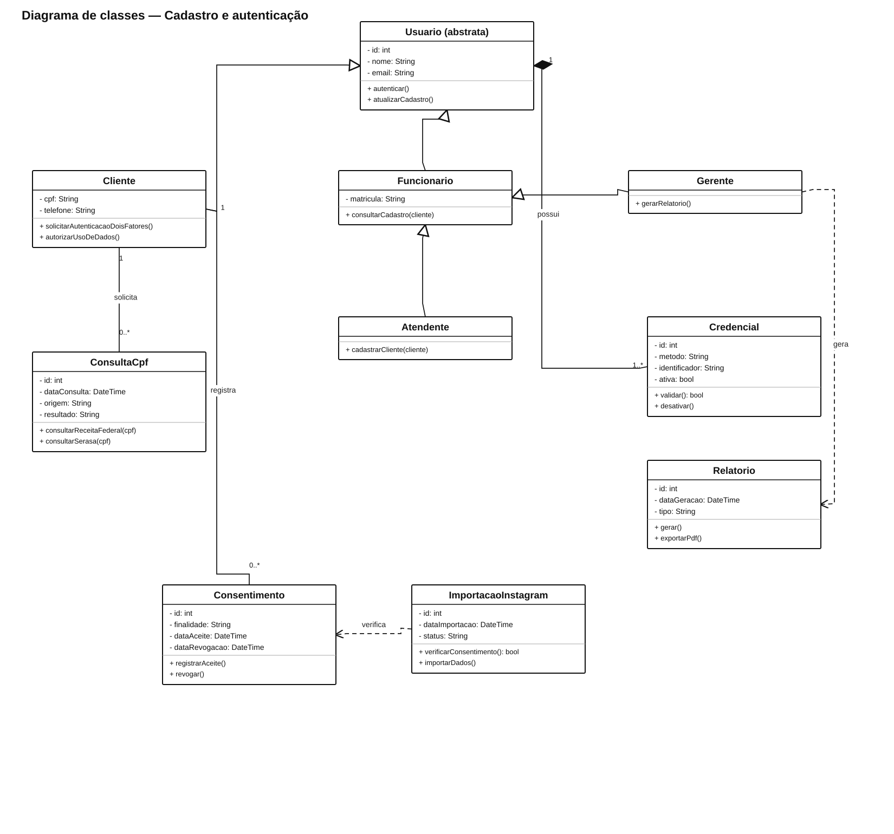
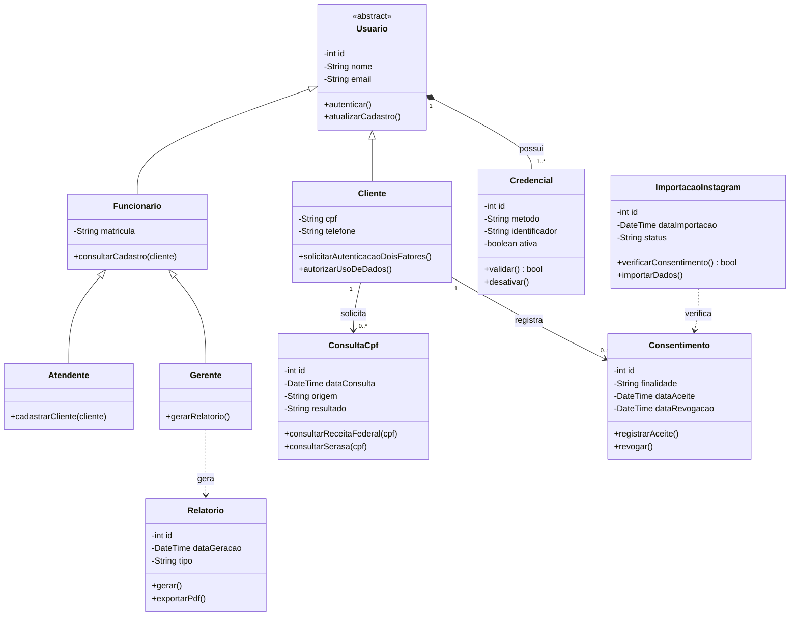

# Cadastro e autenticação

Modelo baseado no exercício “Modelagem Frankenstein”, com cadastro, autenticação, consulta de CPF e consentimento para importar dados.

[Fonte PlantUML editável](Cadastro_Autenticacao.puml)

**Premissas:** biometria e método alternativo aparecem como tipos de credencial, porque o enunciado dá orientações conflitantes sobre a obrigatoriedade da biometria. A importação do Instagram exige consentimento. A classe `Relatorio` fica ligada ao gerente, que é o perfil autorizado a gerar relatórios.
