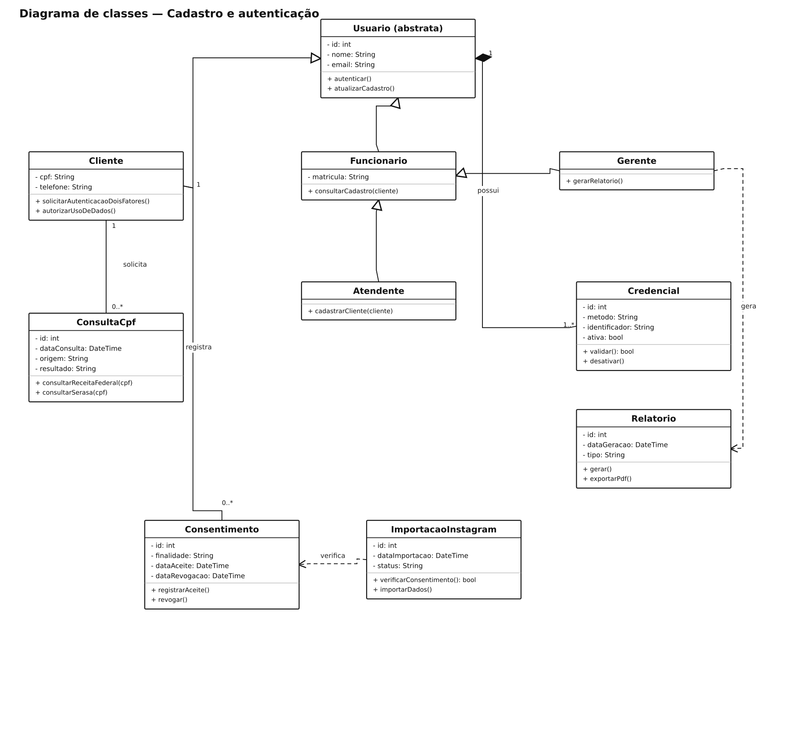

# Cadastro e autenticação — diagramas de classes

## Problema

Sistema de cadastro e acesso baseado no cenário da aula “Modelagem Frankenstein”. O exemplo considera biometria opcional e um método alternativo de acesso.

## Objetivo do diagrama

Identificar as classes, os atributos, as operações e os relacionamentos, incluindo suas multiplicidades.

## Diagrama de estudo

Exemplo de estudo para praticar a notação UML no Lucidchart.

[Abrir imagem](Diagrama.png)

## Leitura do modelo

Modelo baseado no exercício “Modelagem Frankenstein”, com cadastro, autenticação, consulta de CPF e consentimento para importar dados.

**Premissas:** biometria e método alternativo aparecem como tipos de credencial, porque o enunciado dá orientações conflitantes sobre a obrigatoriedade da biometria. A importação do Instagram exige consentimento. A classe `Relatorio` fica ligada ao gerente, que é o perfil autorizado a gerar relatórios.

## Prática no Lucidchart

Usar este problema para montar ou revisar o diagrama manualmente no Lucidchart e exportar a imagem. Quando houver uma nova exportação da atividade, ela deve ficar nesta pasta, com a versão identificada.

[Voltar aos problemas](../README.md) · [Resumo da aula](../ResumoDaAula.md)
