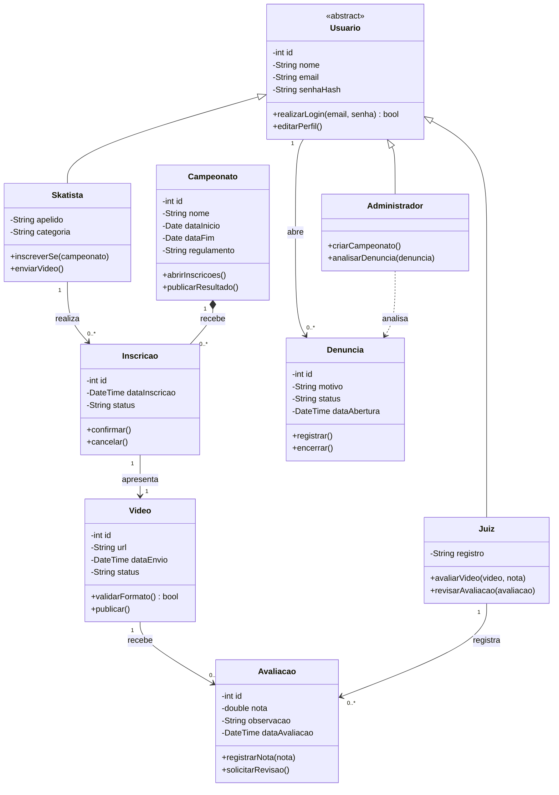

# Campeonato virtual de skate

Modelo de classes para inscrição de skatistas, envio de vídeos e avaliação das participações.

**Premissa:** cada inscrição apresenta um vídeo e pode receber avaliações de vários juízes. A classe `Inscricao` depende do campeonato ao qual pertence.
