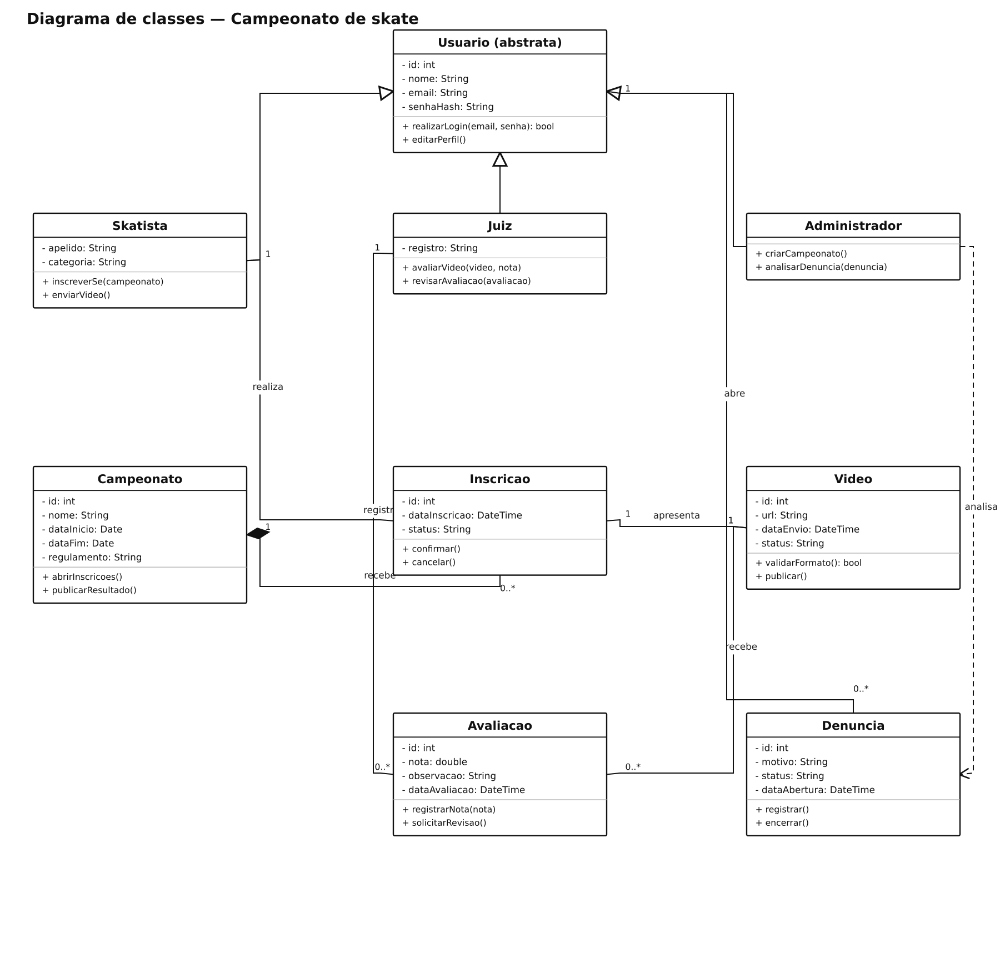

# Campeonato de skate — diagramas de classes

## Problema

Sistema para gerenciar campeonatos virtuais de skate, inscrições, vídeos e avaliações.

## Objetivo do diagrama

Identificar as classes, os atributos, as operações e os relacionamentos, incluindo suas multiplicidades.

## Diagrama de estudo

Exemplo de estudo para praticar a notação UML no Lucidchart.

[Abrir imagem](Diagrama.png)

## Leitura do modelo

Modelo de classes para inscrição de skatistas, envio de vídeos e avaliação das participações.

**Premissa:** cada inscrição apresenta um vídeo e pode receber avaliações de vários juízes. A classe `Inscricao` depende do campeonato ao qual pertence.

## Prática no Lucidchart

Usar este problema para montar ou revisar o diagrama manualmente no Lucidchart e exportar a imagem. Quando houver uma nova exportação da atividade, ela deve ficar nesta pasta, com a versão identificada.

[Voltar aos problemas](../README.md) · [Resumo da aula](../ResumoDaAula.md)
