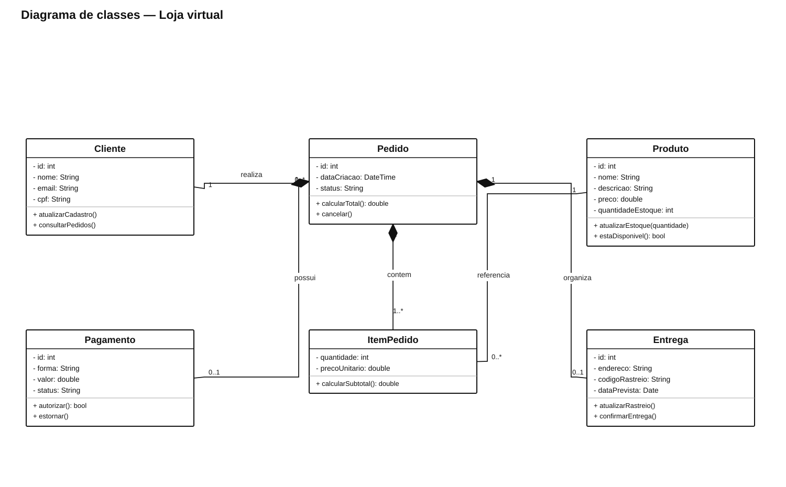
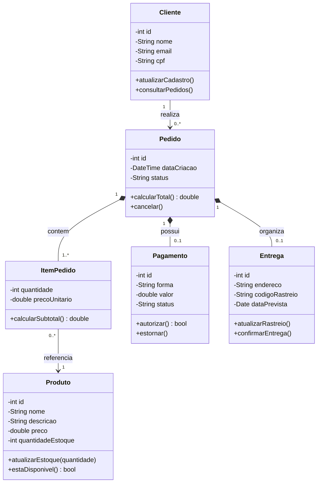

# Loja virtual

Modelo para registrar clientes, pedidos, itens, pagamentos e entregas.

[Fonte PlantUML editável](Loja_Virtual.puml)

**Premissa:** o preço unitário fica no item do pedido para preservar o valor cobrado naquela compra, mesmo que o preço atual do produto mude.
