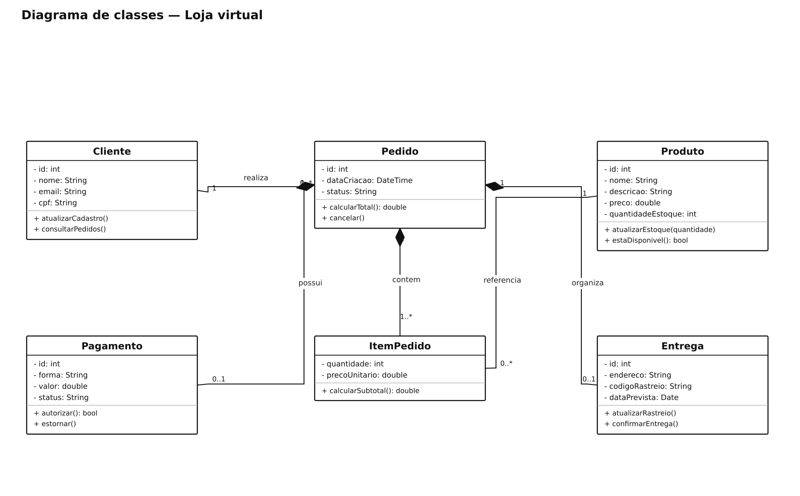

# Loja virtual — diagramas de classes

## Problema

Sistema de loja virtual para consultar produtos, fazer pedidos, pagar e acompanhar entregas.

## Objetivo do diagrama

Identificar as classes, os atributos, as operações e os relacionamentos, incluindo suas multiplicidades.

## Diagrama de estudo

Exemplo de estudo para praticar a notação UML no Lucidchart.

[Abrir imagem](Diagrama.png)

## Leitura do modelo

Modelo para registrar clientes, pedidos, itens, pagamentos e entregas.

**Premissa:** o preço unitário fica no item do pedido para preservar o valor cobrado naquela compra, mesmo que o preço atual do produto mude.

## Prática no Lucidchart

Usar este problema para montar ou revisar o diagrama manualmente no Lucidchart e exportar a imagem. Quando houver uma nova exportação da atividade, ela deve ficar nesta pasta, com a versão identificada.

[Voltar aos problemas](../README.md) · [Resumo da aula](../ResumoDaAula.md)
