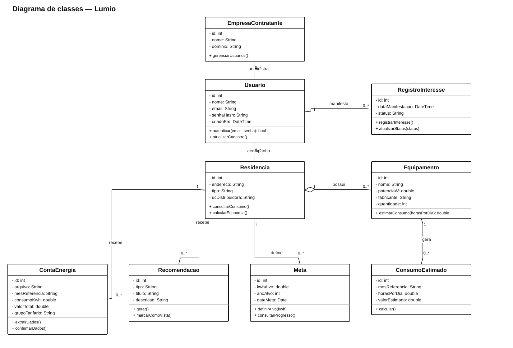
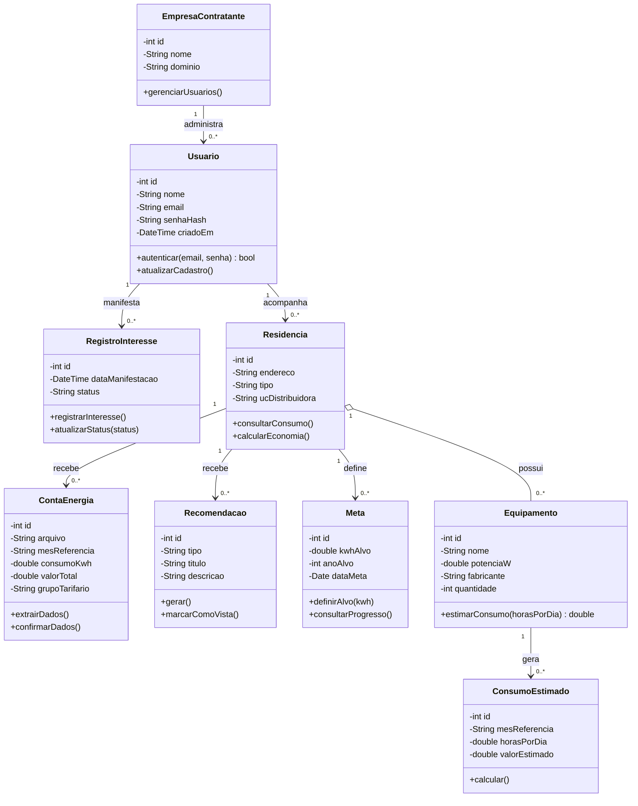

# Lumio

Modelo de classes para acompanhar residências, contas de energia, metas de consumo e recomendações.

[Fonte PlantUML editável](Lumio.puml)

**Premissa:** uma empresa contratante administra usuários da sua plataforma. Cada usuário pode acompanhar várias residências. Os métodos são sugestões de operações do domínio e podem mudar após o diagrama de sequência.
