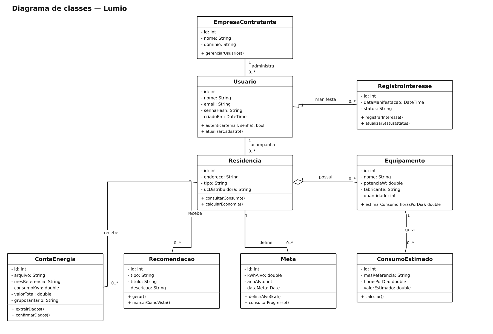

# Lumio — diagramas de classes

## Problema

Sistema para acompanhar contas de energia e analisar o consumo dos usuários.

## Objetivo do diagrama

Identificar as classes, os atributos, as operações e os relacionamentos, incluindo suas multiplicidades.

## Diagrama de estudo

Projeto principal. A imagem abaixo é uma versão de estudo organizada com apoio de IA; não é um arquivo editável do Lucidchart.

[Abrir imagem](Diagrama.png)

## Leitura do modelo

Modelo de classes para acompanhar residências, contas de energia, metas de consumo e recomendações.

**Premissa:** uma empresa contratante administra usuários da sua plataforma. Cada usuário pode acompanhar várias residências. Os métodos são sugestões de operações do domínio e podem mudar após o diagrama de sequência.

## Prática no Lucidchart

Usar este problema para montar ou revisar o diagrama manualmente no Lucidchart e exportar a imagem. Quando houver uma nova exportação da atividade, ela deve ficar nesta pasta, com a versão identificada.

[Voltar aos problemas](../README.md) · [Resumo da aula](../ResumoDaAula.md)
