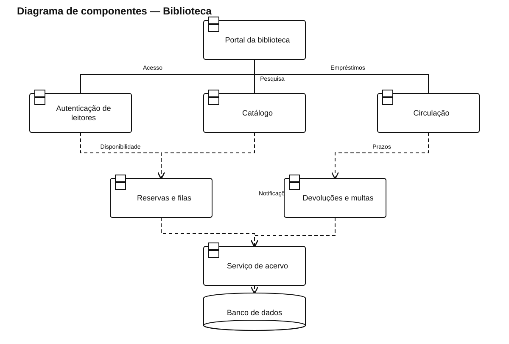

# Diagrama de componentes — Biblioteca

[Ver arquivo SVG](./Biblioteca.svg) · [Abrir fonte PlantUML editável](./Biblioteca.puml)

Divide a aplicação em acesso, catálogo, empréstimos, reservas, multas, notificações e dados do acervo.

As linhas contínuas representam as ligações da interface com os componentes principais. As dependências tracejadas indicam uso de outro componente ou de persistência compartilhada.
