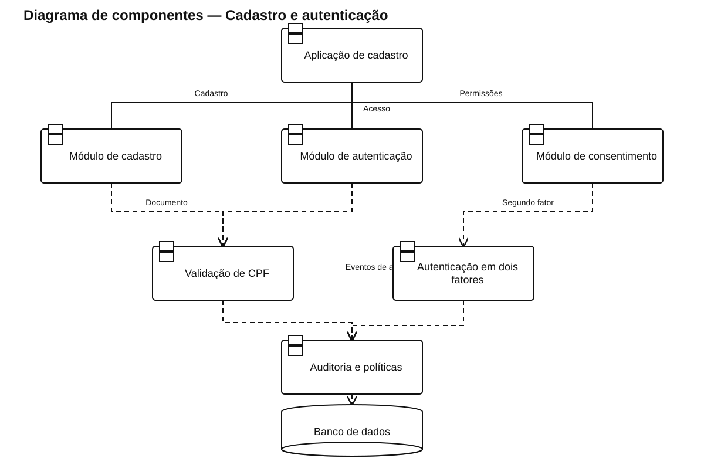

# Diagrama de componentes — Cadastro e autenticação

[Ver arquivo SVG](./Cadastro_Autenticacao.svg) · [Abrir fonte PlantUML editável](./Cadastro_Autenticacao.puml)

Organiza cadastro, autenticação, consentimento, validação de CPF, segundo fator, auditoria e armazenamento.

As linhas contínuas representam as ligações da interface com os componentes principais. As dependências tracejadas indicam uso de outro componente ou de persistência compartilhada.
