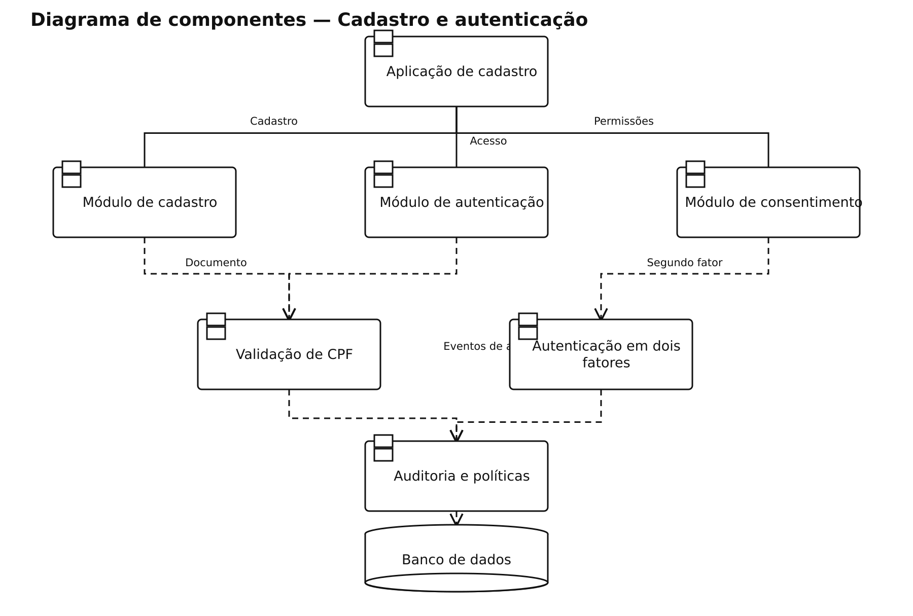

# Cadastro e autenticação — diagramas de componentes

## Problema

Sistema de cadastro e acesso baseado no cenário da aula “Modelagem Frankenstein”. O exemplo considera biometria opcional e um método alternativo de acesso.

## Objetivo do diagrama

Identificar os componentes principais do sistema e as dependências entre eles.

## Diagrama de estudo

Exemplo de estudo para praticar a notação UML no Lucidchart.

[Abrir imagem](Diagrama.png)

## Leitura do modelo

Organiza cadastro, autenticação, consentimento, validação de CPF, segundo fator, auditoria e armazenamento.

As linhas contínuas representam as ligações da interface com os componentes principais. As dependências tracejadas indicam uso de outro componente ou de persistência compartilhada.

## Prática no Lucidchart

Usar este problema para montar ou revisar o diagrama manualmente no Lucidchart e exportar a imagem. Quando houver uma nova exportação da atividade, ela deve ficar nesta pasta, com a versão identificada.

[Voltar aos problemas](../README.md) · [Resumo da aula](../ResumoDaAula.md)
