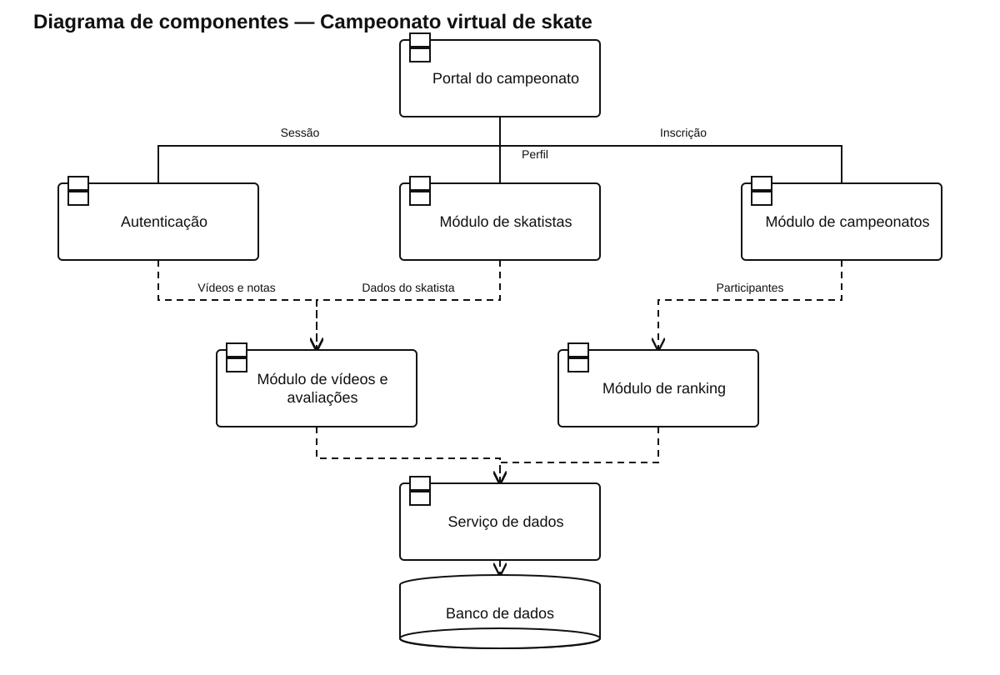

# Diagrama de componentes — Campeonato virtual de skate

[Ver arquivo SVG](./Campeonato_Skate.svg) · [Abrir fonte PlantUML editável](./Campeonato_Skate.puml)

Separa portal, contas, skatistas, campeonatos, vídeos, avaliação e ranking em componentes com responsabilidades claras.

As linhas contínuas representam as ligações da interface com os componentes principais. As dependências tracejadas indicam uso de outro componente ou de persistência compartilhada.
