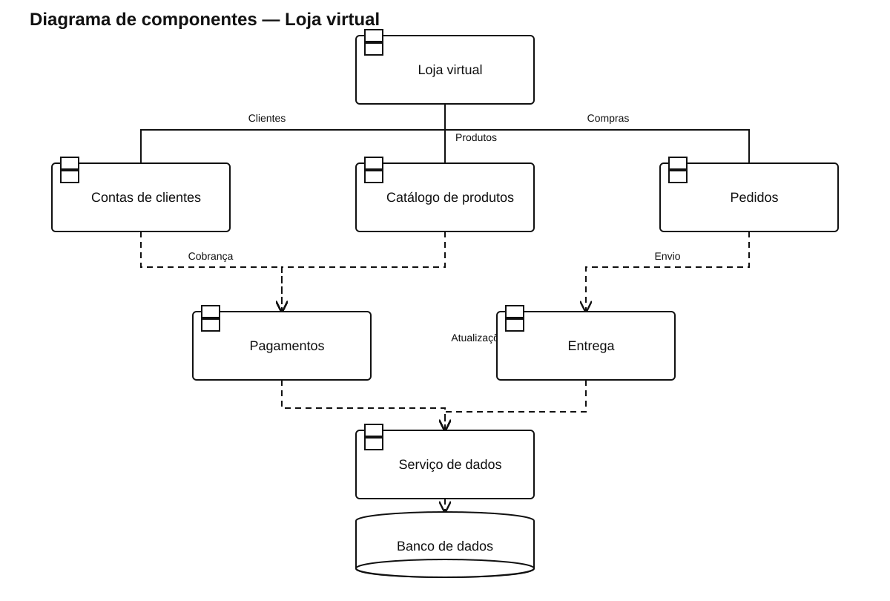

# Diagrama de componentes — Loja virtual

[Ver arquivo SVG](./Loja_Virtual.svg) · [Abrir fonte PlantUML editável](./Loja_Virtual.puml)

Representa clientes, catálogo e pedidos integrados a pagamento, entrega, notificações e banco de dados.

As linhas contínuas representam as ligações da interface com os componentes principais. As dependências tracejadas indicam uso de outro componente ou de persistência compartilhada.
