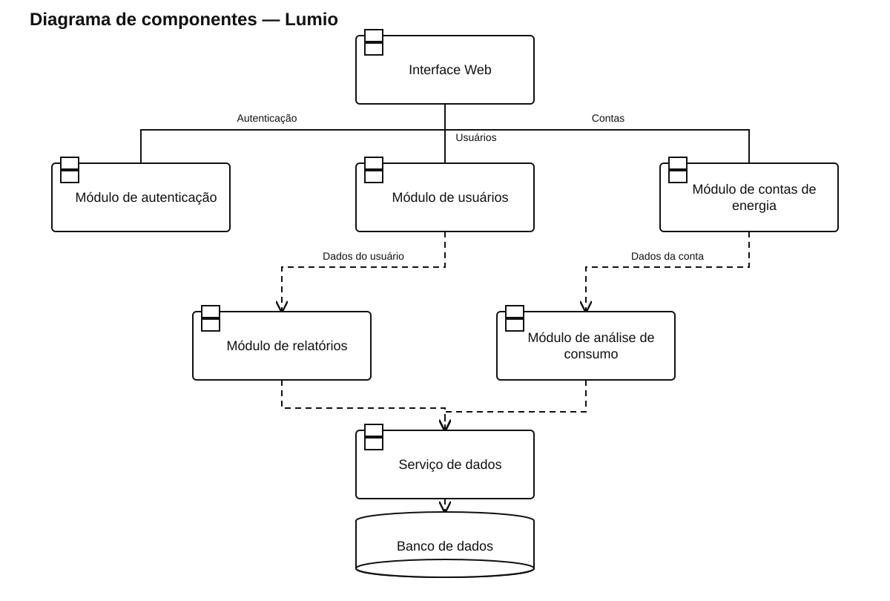

# Diagrama de componentes — Lumio

[Ver arquivo SVG](./Lumio.svg) · [Abrir fonte PlantUML editável](./Lumio.puml)

Mostra a interface web conectada aos módulos de autenticação, usuários e contas de energia, com análise de consumo, relatórios e persistência no banco.

As linhas contínuas representam as ligações da interface com os componentes principais. As dependências tracejadas indicam uso de outro componente ou de persistência compartilhada.
