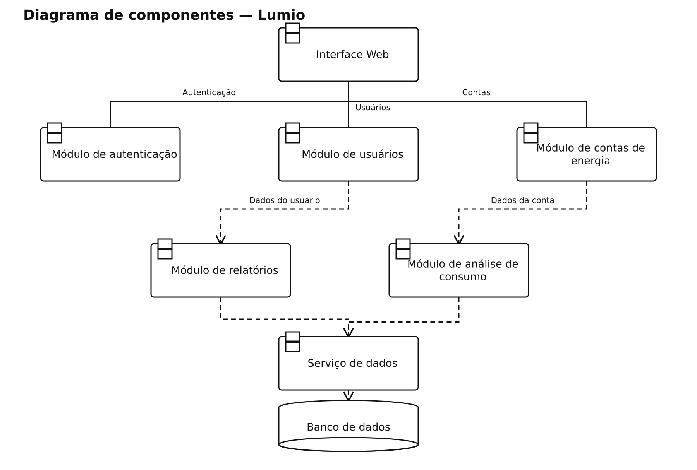

# Lumio — diagramas de componentes

## Problema

Sistema para acompanhar contas de energia e analisar o consumo dos usuários.

## Objetivo do diagrama

Identificar os componentes principais do sistema e as dependências entre eles.

## Diagrama de estudo

Projeto principal. A imagem abaixo é uma versão de estudo organizada com apoio de IA; não é um arquivo editável do Lucidchart.

[Abrir imagem](Diagrama.png)

## Leitura do modelo

Mostra a interface web conectada aos módulos de autenticação, usuários e contas de energia, com análise de consumo, relatórios e persistência no banco.

As linhas contínuas representam as ligações da interface com os componentes principais. As dependências tracejadas indicam uso de outro componente ou de persistência compartilhada.

## Prática no Lucidchart

Usar este problema para montar ou revisar o diagrama manualmente no Lucidchart e exportar a imagem. Quando houver uma nova exportação da atividade, ela deve ficar nesta pasta, com a versão identificada.

[Voltar aos problemas](../README.md) · [Resumo da aula](../ResumoDaAula.md)
