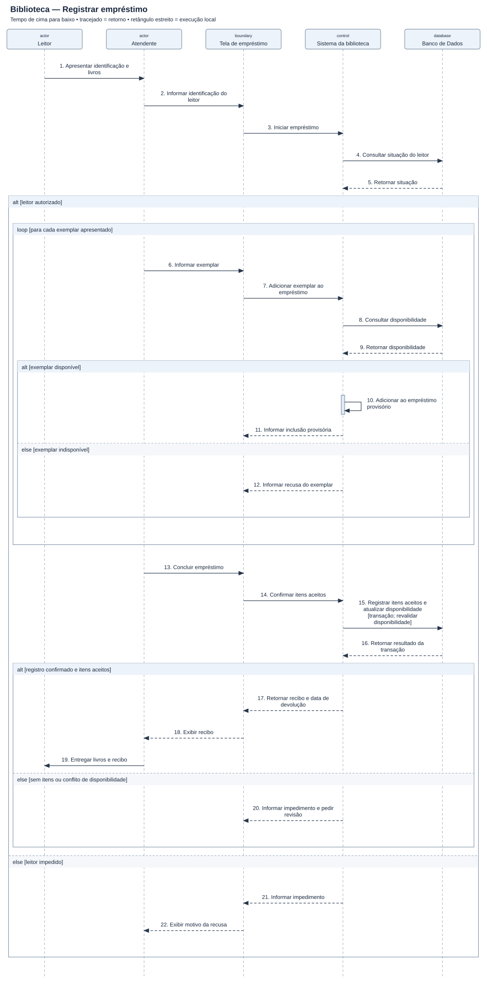

# Diagrama de sequência — Biblioteca — Registrar empréstimo

[Imagem SVG](./Biblioteca.svg) · [Fonte PlantUML editável](./Biblioteca.puml)

**Pré-condição:** Atendente autenticado; leitor e exemplares cadastrados.

**Fluxo:** O atendente identifica o leitor, inclui os exemplares disponíveis e conclui o empréstimo. A gravação revalida a disponibilidade em uma transação.

**Alternativas e limites:** Leitor impedido, exemplar indisponível, lista vazia ou conflito na confirmação impedem total ou parcialmente o empréstimo.
