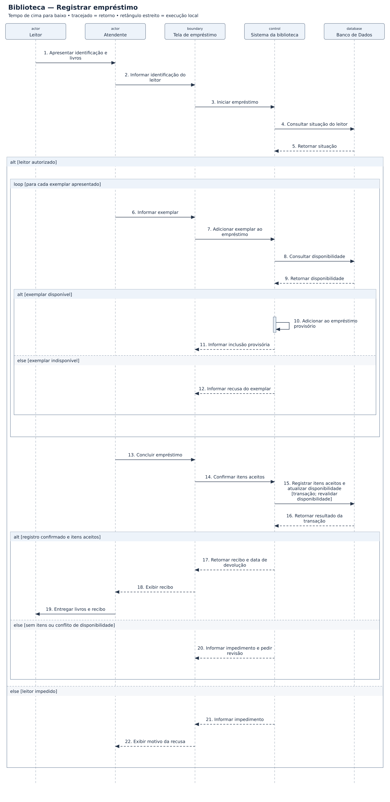

# Biblioteca — diagramas de sequência

## Problema

Sistema de biblioteca para cadastrar leitores e livros e controlar empréstimos, devoluções e reservas.

## Objetivo do diagrama

Mostrar, em ordem, quem envia cada mensagem, quem recebe e como o sistema responde ao cenário.

## Diagrama de estudo

Exemplo complementar organizado com apoio de IA para praticar a notação. Referência para praticar no Lucidchart.

[Abrir imagem](Diagrama.png)

## Leitura do modelo

**Pré-condição:** Atendente autenticado; leitor e exemplares cadastrados.

**Fluxo:** O atendente identifica o leitor, inclui os exemplares disponíveis e conclui o empréstimo. A gravação revalida a disponibilidade em uma transação.

**Alternativas e limites:** Leitor impedido, exemplar indisponível, lista vazia ou conflito na confirmação impedem total ou parcialmente o empréstimo.

## Prática no Lucidchart

Usar este problema para montar ou revisar o diagrama manualmente no Lucidchart e exportar a imagem. Quando houver uma nova exportação da atividade, ela deve ficar nesta pasta, com a versão identificada.

[Voltar aos problemas](../README.md) · [Resumo da aula](../ResumoDaAula.md)
