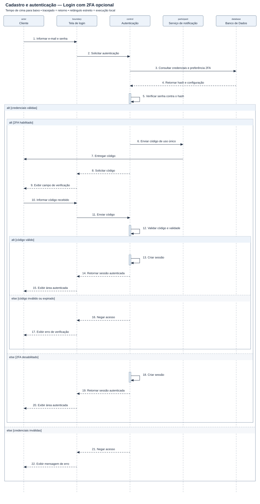

# Diagrama de sequência — Cadastro e autenticação — Login com 2FA opcional

[Imagem SVG](./Cadastro_Autenticacao.svg) · [Fonte PlantUML editável](./Cadastro_Autenticacao.puml)

**Pré-condição:** Cliente cadastrado e canal do segundo fator previamente configurado, quando habilitado.

**Fluxo:** O sistema verifica a senha e exige o código apenas quando o segundo fator está habilitado. A sessão só é criada depois das verificações aplicáveis.

**Alternativas e limites:** Senha incorreta ou código inválido/expirado impedem a criação da sessão. Este recorte usa senha como alternativa à biometria; não modela cadastro nem recuperação de conta.
