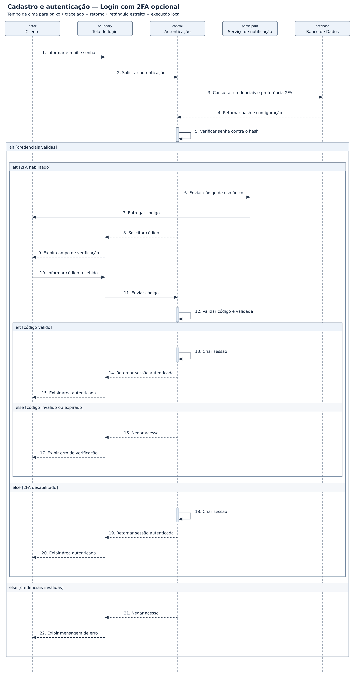

# Cadastro e autenticação — diagramas de sequência

## Problema

Sistema de cadastro e acesso baseado no cenário da aula “Modelagem Frankenstein”. O exemplo considera biometria opcional e um método alternativo de acesso.

## Objetivo do diagrama

Mostrar, em ordem, quem envia cada mensagem, quem recebe e como o sistema responde ao cenário.

## Diagrama de estudo

Exemplo de estudo para praticar a notação UML no Lucidchart.

[Abrir imagem](Diagrama.png)

## Leitura do modelo

**Pré-condição:** Cliente cadastrado e canal do segundo fator previamente configurado, quando habilitado.

**Fluxo:** O sistema verifica a senha e exige o código apenas quando o segundo fator está habilitado. A sessão só é criada depois das verificações aplicáveis.

**Alternativas e limites:** Senha incorreta ou código inválido/expirado impedem a criação da sessão. Este recorte usa senha como alternativa à biometria; não modela cadastro nem recuperação de conta.

## Prática no Lucidchart

Usar este problema para montar ou revisar o diagrama manualmente no Lucidchart e exportar a imagem. Quando houver uma nova exportação da atividade, ela deve ficar nesta pasta, com a versão identificada.

[Voltar aos problemas](../README.md) · [Resumo da aula](../ResumoDaAula.md)
