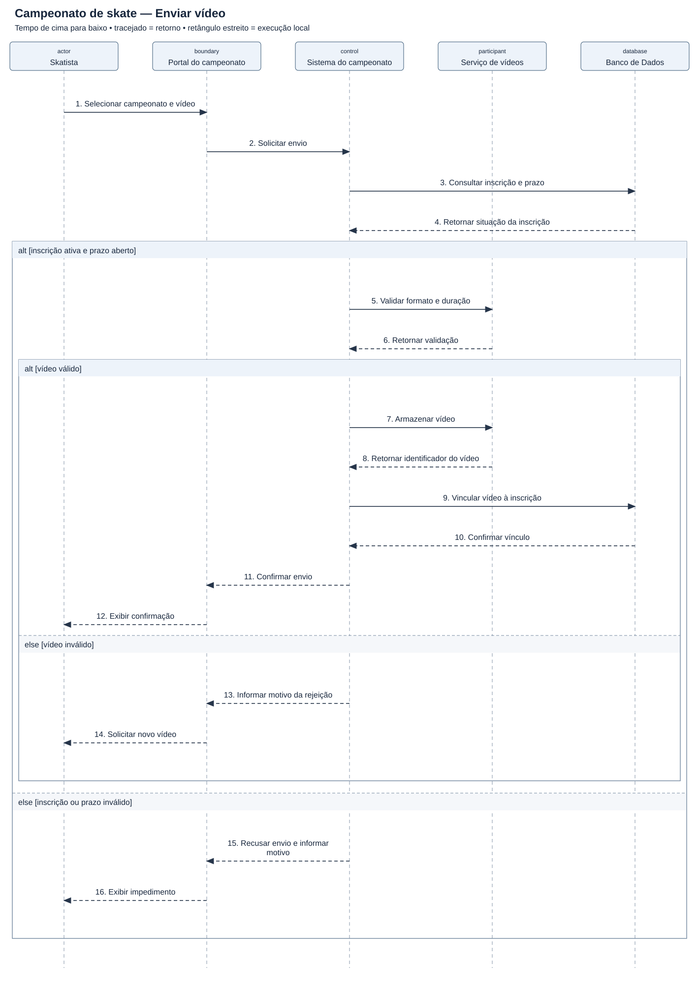

# Diagrama de sequência — Campeonato de skate — Enviar vídeo

[Imagem SVG](./Campeonato_Skate.svg) · [Fonte PlantUML editável](./Campeonato_Skate.puml)

**Pré-condição:** Skatista autenticado e campeonato existente.

**Fluxo:** O sistema verifica a inscrição e o prazo, valida o vídeo e registra o vínculo com a inscrição.

**Alternativas e limites:** Inscrição inativa, prazo encerrado ou vídeo fora das regras impedem o envio. Falhas de armazenamento e compensação de vídeo órfão ficam fora deste recorte.
