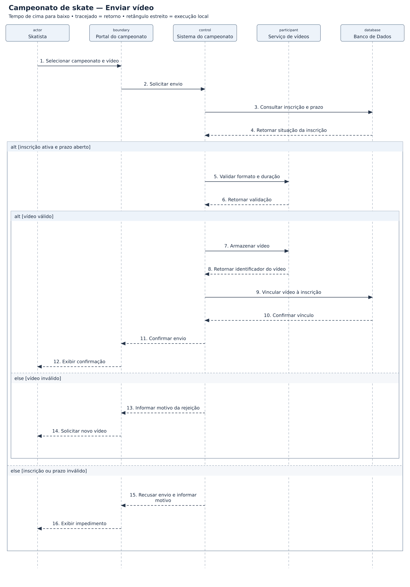

# Campeonato de skate — diagramas de sequência

## Problema

Sistema para gerenciar campeonatos virtuais de skate, inscrições, vídeos e avaliações.

## Objetivo do diagrama

Mostrar, em ordem, quem envia cada mensagem, quem recebe e como o sistema responde ao cenário.

## Diagrama de estudo

Exemplo de estudo para praticar a notação UML no Lucidchart.

[Abrir imagem](Diagrama.png)

## Leitura do modelo

**Pré-condição:** Skatista autenticado e campeonato existente.

**Fluxo:** O sistema verifica a inscrição e o prazo, valida o vídeo e registra o vínculo com a inscrição.

**Alternativas e limites:** Inscrição inativa, prazo encerrado ou vídeo fora das regras impedem o envio. Falhas de armazenamento e compensação de vídeo órfão ficam fora deste recorte.

## Prática no Lucidchart

Usar este problema para montar ou revisar o diagrama manualmente no Lucidchart e exportar a imagem. Quando houver uma nova exportação da atividade, ela deve ficar nesta pasta, com a versão identificada.

[Voltar aos problemas](../README.md) · [Resumo da aula](../ResumoDaAula.md)
