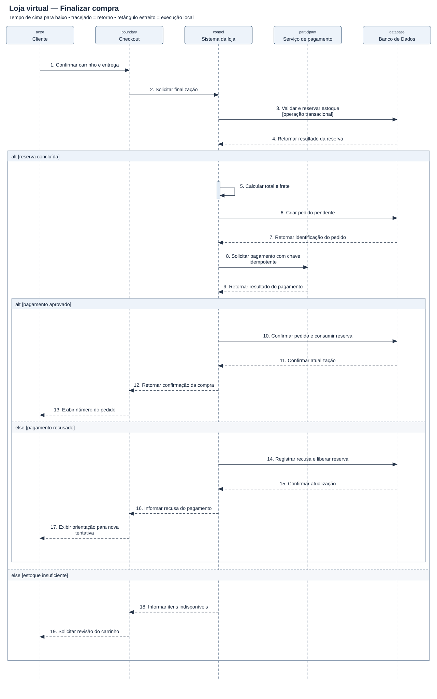

# Diagrama de sequência — Loja virtual — Finalizar compra

[Imagem SVG](./Loja_Virtual.svg) · [Fonte PlantUML editável](./Loja_Virtual.puml)

**Pré-condição:** Cliente autenticado, carrinho preenchido e endereço informado.

**Fluxo:** A loja reserva estoque, cria um pedido pendente e solicita pagamento. Com aprovação, confirma o pedido; com recusa, libera a reserva.

**Alternativas e limites:** O exemplo supõe resposta imediata do pagamento. Timeout, confirmação por webhook, expiração da reserva e falha de gravação após cobrança precisam de fluxos adicionais.
