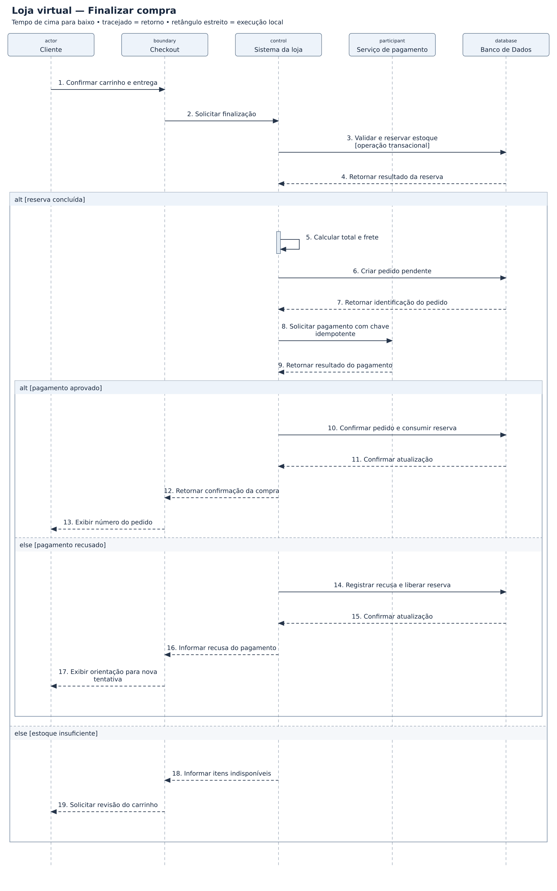

# Loja virtual — diagramas de sequência

## Problema

Sistema de loja virtual para consultar produtos, fazer pedidos, pagar e acompanhar entregas.

## Objetivo do diagrama

Mostrar, em ordem, quem envia cada mensagem, quem recebe e como o sistema responde ao cenário.

## Diagrama de estudo

Exemplo de estudo para praticar a notação UML no Lucidchart.

[Abrir imagem](Diagrama.png)

## Leitura do modelo

**Pré-condição:** Cliente autenticado, carrinho preenchido e endereço informado.

**Fluxo:** A loja reserva estoque, cria um pedido pendente e solicita pagamento. Com aprovação, confirma o pedido; com recusa, libera a reserva.

**Alternativas e limites:** O exemplo supõe resposta imediata do pagamento. Timeout, confirmação por webhook, expiração da reserva e falha de gravação após cobrança precisam de fluxos adicionais.

## Prática no Lucidchart

Usar este problema para montar ou revisar o diagrama manualmente no Lucidchart e exportar a imagem. Quando houver uma nova exportação da atividade, ela deve ficar nesta pasta, com a versão identificada.

[Voltar aos problemas](../README.md) · [Resumo da aula](../ResumoDaAula.md)
