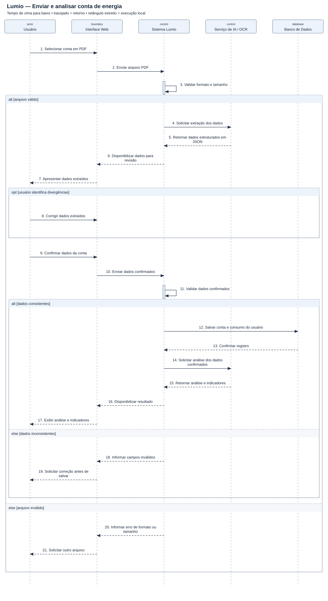

# Diagrama de sequência — Lumio — Enviar e analisar conta de energia

[Imagem SVG](./Lumio.svg) · [Fonte PlantUML editável](./Lumio.puml)

**Pré-condição:** Usuário autenticado, com uma conta de energia em PDF.

**Fluxo:** O usuário envia a conta, revisa a extração, confirma os dados e recebe os indicadores. A análise só é solicitada após a confirmação e o registro da conta.

**Alternativas e limites:** Arquivo inválido e dados inconsistentes impedem o salvamento. A indisponibilidade do OCR/IA e falhas de persistência exigem fluxos próprios em um detalhamento posterior.

## Revisão do original

O original de Nathalia Gongora Lopes (versão 2, 30/09/2026) foi preservado em [Referencias/Lumio_Original.png](./Referencias/Lumio_Original.png).

- Mantidos os cinco participantes e a revisão humana antes de salvar.
- Corrigida a mensagem de confirmação do banco: ela retorna diretamente ao Sistema Lumio.
- Acrescentada uma solicitação explícita de análise ao serviço de IA antes do retorno dos indicadores. No original, “Emite Relatorio” aparece como retorno sem chamada correspondente.
- Acrescentadas validação do arquivo, validação dos dados confirmados e alternativas de erro. São complementos didáticos, não novas exigências identificadas nos slides.
- Barras de execução do original precisam começar na recepção da chamada e cobrir o processamento correspondente. A versão revisada omite barras em chamadas remotas e destaca apenas execuções locais; a linha de vida continua existindo após cada retorno.

O cenário supõe extração bem-sucedida e respostas imediatas dos serviços. Os indicadores só são apresentados após os dados confirmados serem gravados.
