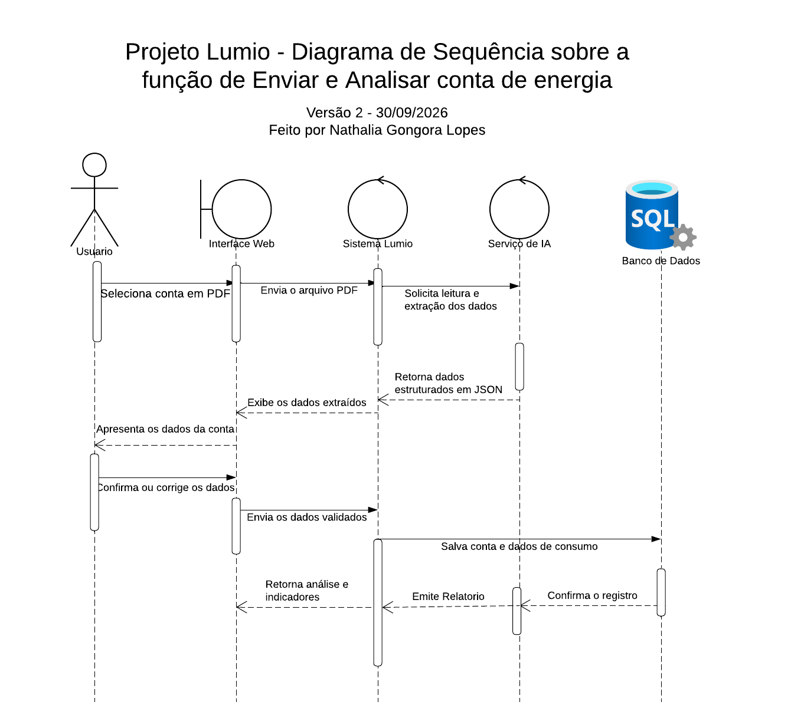
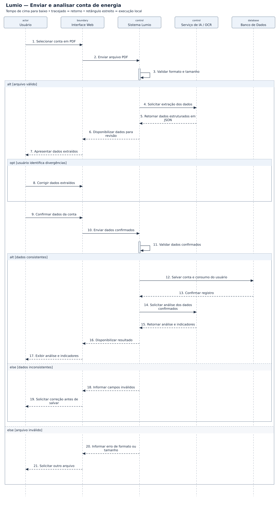

# Lumio — diagramas de sequência

## Problema

Sistema para acompanhar contas de energia e analisar o consumo dos usuários.

## Objetivo do diagrama

Mostrar, em ordem, quem envia cada mensagem, quem recebe e como o sistema responde ao cenário.

## Meu diagrama da aula

[Abrir meu original](Original_Lucidchart.png)

Na versão de estudo, a confirmação do banco retorna diretamente ao Sistema Lumio. Também foi incluída uma solicitação de análise ao serviço de IA antes do retorno dos indicadores: no original, o relatório retornava sem essa solicitação. As validações e alternativas de erro são complementos para estudo.

## Diagrama de estudo

Projeto principal. A imagem abaixo é uma versão de estudo organizada com apoio de IA; não é um arquivo editável do Lucidchart.

[Abrir imagem](Diagrama.png)

## Leitura do modelo

**Pré-condição:** Usuário autenticado, com uma conta de energia em PDF.

**Fluxo:** O usuário envia a conta, revisa a extração, confirma os dados e recebe os indicadores. A análise só é solicitada após a confirmação e o registro da conta.

**Alternativas e limites:** Arquivo inválido e dados inconsistentes impedem o salvamento. A indisponibilidade do OCR/IA e falhas de persistência exigem fluxos próprios em um detalhamento posterior.

## Prática no Lucidchart

Usar este problema para montar ou revisar o diagrama manualmente no Lucidchart e exportar a imagem. Quando houver uma nova exportação da atividade, ela deve ficar nesta pasta, com a versão identificada.

[Voltar aos problemas](../README.md) · [Resumo da aula](../ResumoDaAula.md)
