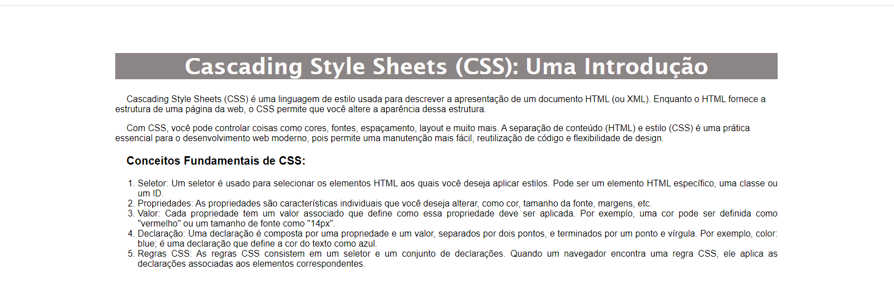

# Exercício 01 — Introducao Ao CSS

**Origem:** Lista do professor.

## Enunciado

Crie uma página HTML com o texto introdutório sobre CSS e a lista de conceitos fornecidos na atividade. Faça as seguintes alterações no texto com o auxílio do CSS
Altere a cor do fundo para uma tonalidade de marrom claro, o tamanho do texto para 40px, cor da letra branca, alinhe o texto no centro e a fonte da letra para “Lucida Sans”
Ao passar o mouse sobre o título o fundo deve mudar para a cor preta.
O conteúdo da página deve ser mostrado com a fonte “Arial”.
Todos os parágrafos devem ter um recuo de 20px.
O título introdutório da lista ordenada que possui a escrita: “Conceitos Fundamentais de CSS:” deve estar com seu texto em negrito e a letra deve ter o tamanho de 20x.
Os itens da lista devem estar com alinhamento justificado.
Todo o conteúdo da página precisa ter um espaçamento superior e inferior de 50px e os lados precisam ter um espaçamento de 200px

## Referência visual da lista

## Executar

Abra [index.html](index.html) no navegador depois de baixar ou clonar a pasta. No GitHub, o link mostra o código-fonte.

O primeiro item se aplica ao título, conforme o print da lista. O valor “20x” foi interpretado como 20px. Em telas pequenas, as margens laterais são reduzidas para manter a leitura.

[Voltar à aula](../README.md)
