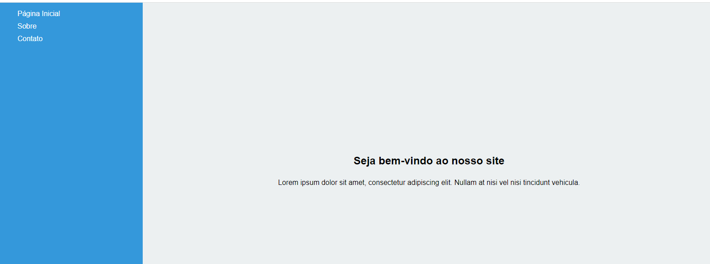

# Exercício 01 — Barra Lateral e Conteudo

**Origem:** Lista do professor.

## Enunciado

Crie uma estrutura HTML básica com uma 
 para a barra lateral e outra 
 para o conteúdo principal.
Estilize a barra lateral com as seguintes propriedades:
Largura de 20% da largura total da página.
Altura de 100% da altura da janela de visualização.
Cor de fundo diferente da cor de fundo do conteúdo principal.
Conteúdo de texto dentro da barra lateral, como links de navegação.
Estilize o conteúdo principal com as seguintes propriedades:
Largura de 80% da largura total da página.
Altura de 100% da altura da janela de visualização.
Cor de fundo diferente da cor de fundo da barra lateral.
Alinhe o conteúdo no centro vertical e horizontalmente.
Use a propriedade float para fazer com que a barra lateral flutue à esquerda e o conteúdo principal flutue à direita.
Use a propriedade position para posicionar a barra lateral e o conteúdo principal de forma que eles ocupem toda a altura da janela de visualização, independentemente do tamanho do conteúdo.
Teste o layout redimensionando a janela do navegador para verificar se ele é responsivo.

## Referência visual da lista

## Executar

Abra [index.html](index.html) no navegador depois de baixar ou clonar a pasta. No GitHub, o link mostra o código-fonte.

[Voltar à aula](../README.md)
