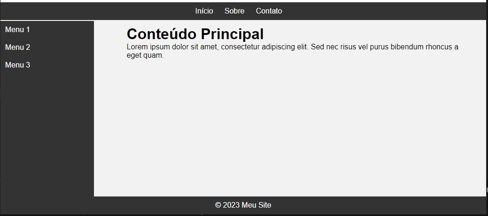

# Exercício 02 — Menus Fixos e Rodape

**Origem:** Lista do professor.

## Enunciado

Crie uma página HTML que tenha a seguinte estrutura de layout:
Um menu superior fixo no topo da página.
Um menu lateral à esquerda que ocupe uma parte da largura da página.
Uma área de conteúdo à direita do menu lateral.
Um rodapé fixo na parte inferior da página.
Use a propriedade position do CSS para posicionar os elementos da seguinte maneira:
O menu superior deve ter position: fixed; para permanecer fixo no topo da página.
O menu lateral deve ter position: fixed; para permanecer fixo à esquerda da página.
A área de conteúdo deve ter margin-left para deixar espaço para o menu lateral e não ser ocultada por ele.
O rodapé deve ter position: fixed; para permanecer fixo na parte inferior da página.
Personalize os estilos e os conteúdos dos menus e do conteúdo conforme desejar.

## Referência visual da lista

## Executar

Abra [index.html](index.html) no navegador depois de baixar ou clonar a pasta. No GitHub, o link mostra o código-fonte.

[Voltar à aula](../README.md)
