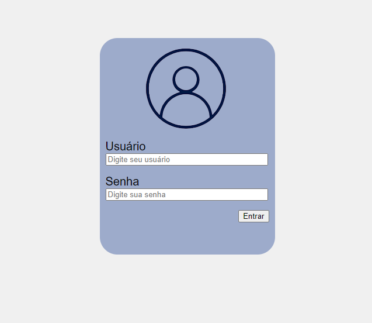

# Exercício 01 — Login Centralizado

**Origem:** Lista do professor.

## Enunciado

Com o auxílio do Flexbox, faça uma tela de login centralizada na página, conforme a imagem da lista.

## Referência visual da lista

## Executar

Abra [index.html](index.html) no navegador depois de baixar ou clonar a pasta. No GitHub, o link mostra o código-fonte.

O desenho do usuário foi feito com CSS. O formulário demonstra o layout; não autentica nem armazena a senha.

[Voltar à aula](../README.md)
