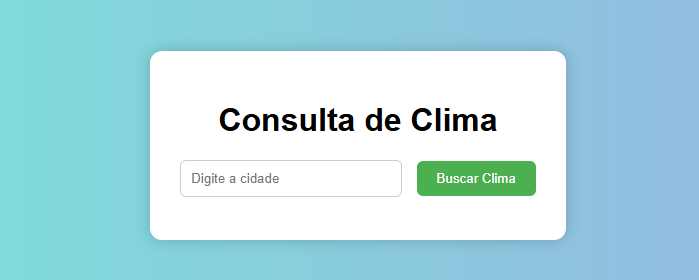
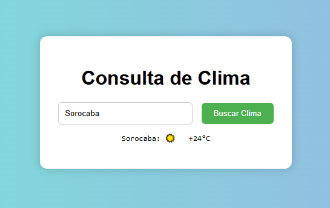

# Exercício 01 — Previsão do tempo

**Origem:** atividade do professor, “10 - AJAX Previsao do Tempo-1.docx”.

## Enunciado

Crie uma página de consulta de previsão do tempo conforme o modelo da lista. Ao digitar o nome da cidade e clicar em “Buscar Clima”, apresente as informações retornadas por https://wttr.in/Sorocaba?format=3 para a cidade informada.

## Executar

Abra [index.html](index.html) por um servidor local, como o Live Server do VS Code. Digite uma cidade e clique em **Buscar Clima** ou pressione Enter. É necessário acesso à internet. No GitHub, o link mostra o código-fonte.

O código segue a organização dos exemplos de aula: evento do formulário, função `pesquisar`, função de consulta e `fetch` com `async/await`. A cidade é codificada com `encodeURIComponent` para preservar espaços e acentos na URL. Como `format=3` retorna texto, a leitura usa `resposta.text()`.

O resultado aparece sem recarregar a página. A interface trata entrada vazia, erro HTTP e falha na consulta e restaura o botão ao finalizar. A precisão da localização e os dados retornados dependem do serviço, inclusive para cidades com nomes iguais. O exercício exibe a resposta fornecida, sem inventar informações quando a consulta falha.

## Modelo fornecido pelo professor

As imagens são referências do enunciado, não capturas de testes desta implementação.

[Documentação do wttr.in](https://github.com/chubin/wttr.in) · [Voltar a AJAX](../README.md)
